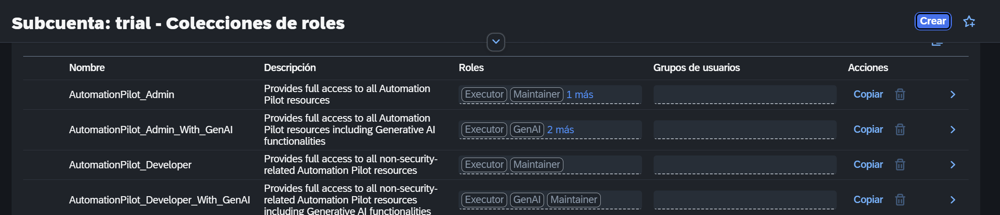
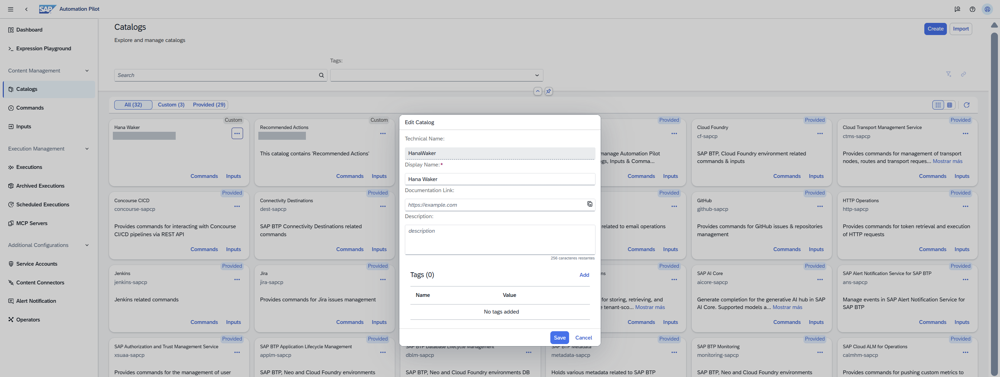
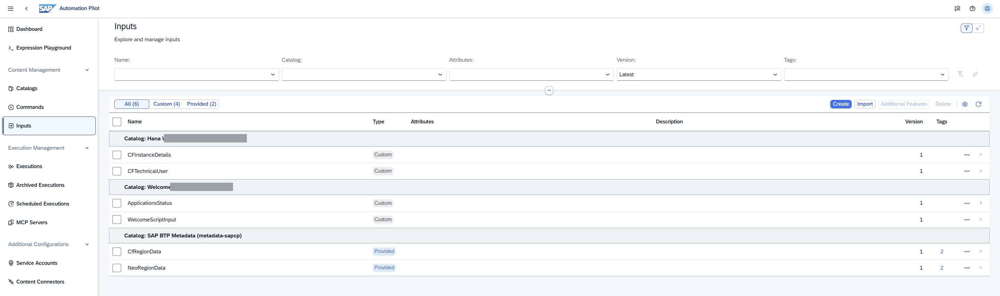
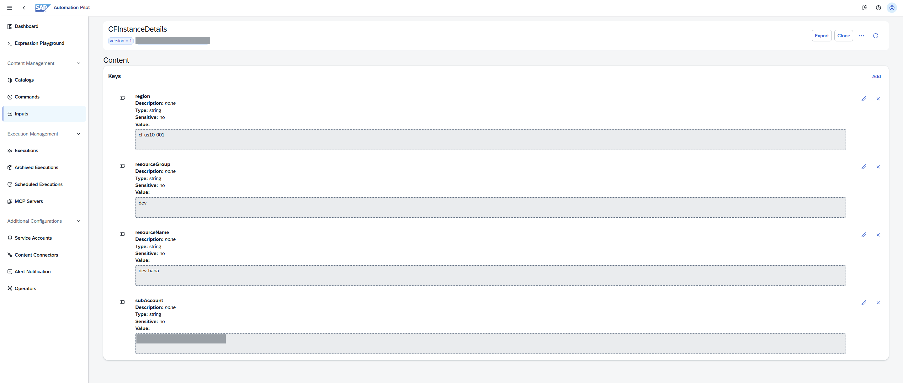
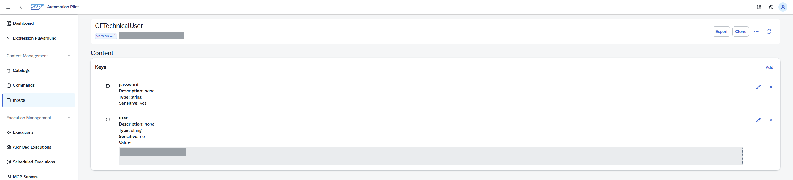
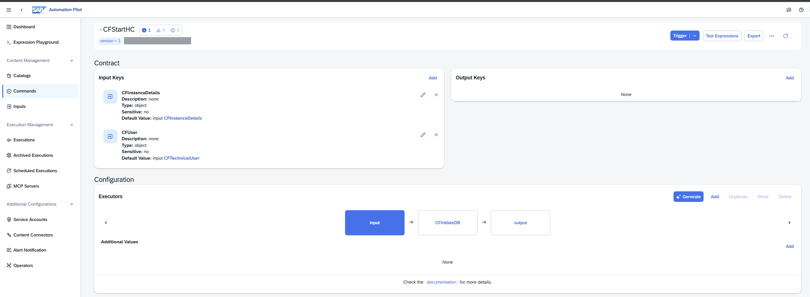
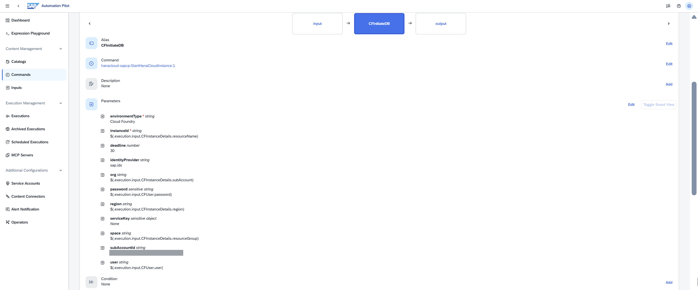
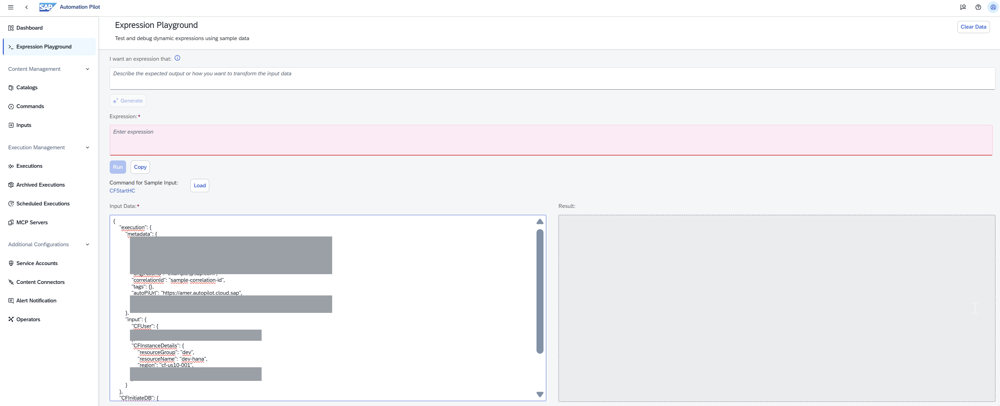
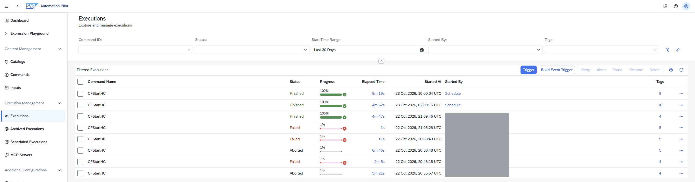
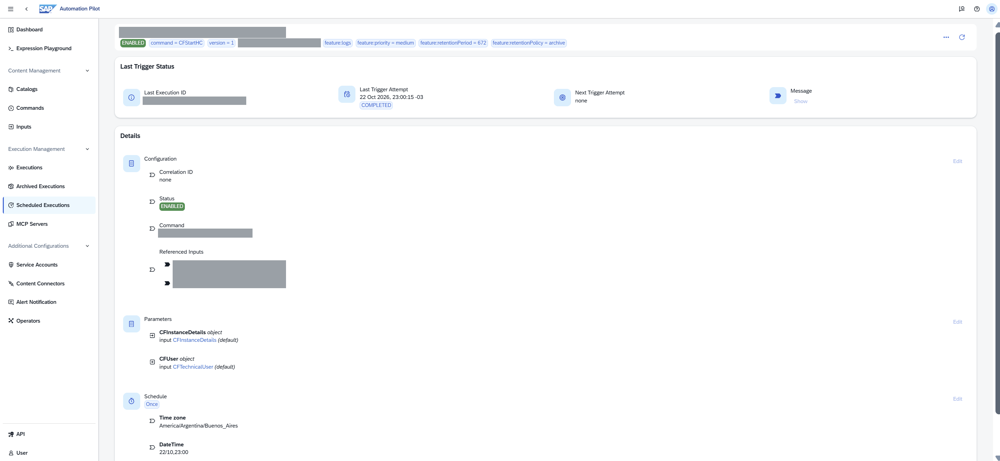

## El problema

En una cuenta **trial** (y en el free tier) de SAP BTP, la instancia de **SAP HANA Cloud se apaga todas las noches**. Cada mañana hay que entrar a HANA Cloud Central y darle *Start*, y esperar unos minutos antes de poder trabajar.

La primera idea es una app con un cron que la arranque. En trial **no sirve**: Cloud Foundry también frena **todas las apps** cada noche (alrededor de las 00:10 UTC), así que el cron que vive dentro de la app nunca llega a correr.

Otras opciones que probé:

| Opción | Resultado |
|---|---|
| Cron dentro de una app de CF | En trial la app está frenada a la hora del cron. |
| GitHub Actions (`schedule`) que hace `cf start` | Funciona, pero GitHub **no garantiza el horario**: con carga lo demora o lo descarta. |
| **SAP Automation Pilot** | Es SaaS: no lo afecta el apagado nocturno de CF. ✅ |

## Qué es Automation Pilot

Un servicio de BTP para automatizar tareas de operación con **comandos** (pasos encadenados) que se pueden lanzar a mano, por API o con **ejecuciones programadas**. Trae catálogos de comandos de SAP listos, entre ellos uno para arrancar HANA Cloud y otros para manejar apps de Cloud Foundry.

Está disponible en la trial y tiene plan `free` en el free tier. Si lo activás en una cuenta de empresa, elegí explícitamente el plan **free** en *Entitlements* (el `standard` se cobra por uso).

Después de suscribirte, asignate una de sus role collections en la subaccount (*Security → Role Collections*). `AutomationPilot_Developer` alcanza para crear catálogos, inputs y comandos; `AutomationPilot_Admin` suma lo relacionado con seguridad.



## Paso 1: un usuario técnico

Los comandos se autentican contra Cloud Foundry con usuario y contraseña (password grant), así que:

- Creá un usuario **dedicado** (SAP ID service o el IdP de la subaccount), **sin 2FA**: el password grant no la soporta.
- Dale solo **Space Developer** en el space donde está la instancia. Nada más.

```sh
cf set-space-role <usuario> <org> <space> SpaceDeveloper
```

> Sin 2FA, la contraseña es lo único que protege a ese usuario: que sea larga, única y que no tenga más permisos que ese space.

## Paso 2: catálogo e inputs

En Automation Pilot:

1. **Catalogs → Create**: un catálogo propio (por ejemplo `HanaWaker`). Los de SAP aparecen como *Provided*; el tuyo, como *Custom*.

   

2. **Inputs → Create**, dos inputs dentro de ese catálogo:

   

**`CFInstanceDetails`** (dónde está la instancia):

| Clave | Valor de ejemplo | Nota |
|---|---|---|
| `region` | `cf-us10-001` | Ver la trampa 2 más abajo. |
| `subAccount` | `<org>` | El **org** de CF, no el nombre de la subaccount. |
| `resourceGroup` | `dev` | El **space**. |
| `resourceName` | `dev-hana` | Nombre de la instancia de HANA Cloud. |



**`CFTechnicalUser`** (credenciales):

| Clave | Valor | Nota |
|---|---|---|
| `user` | `<usuario técnico>` | |
| `password` | `<contraseña>` | Marcala como **Sensitive**: no se vuelve a mostrar. |



## Paso 3: el comando

**Commands → Create** en tu catálogo (por ejemplo `CFStartHC`):

- **Input keys:** `CFInstanceDetails` y `CFUser`, de tipo **object**, con los inputs del paso 2 como valor por defecto.
- **Executor** (por ejemplo `CFInitiateDB`) con el comando de SAP **`hanacloud-sapcp:StartHanaCloudInstance:1`**.



> El tutorial de developers.sap.com usa `dblm-sapcp`, que está **deprecado**, y una sintaxis de expresiones vieja. Usá `hanacloud-sapcp`.

Parámetros del executor:

| Parámetro | Valor |
|---|---|
| `environmentType` | `Cloud Foundry` |
| `instanceId` | `$(.execution.input.CFInstanceDetails.resourceName)` |
| `region` | `$(.execution.input.CFInstanceDetails.region)` |
| `org` | `$(.execution.input.CFInstanceDetails.subAccount)` |
| `space` | `$(.execution.input.CFInstanceDetails.resourceGroup)` |
| `user` | `$(.execution.input.CFUser.user)` |
| `password` | `$(.execution.input.CFUser.password)` |
| `identityProvider` | `sap.ids` (o el origin de tu IdP) |
| `deadline` | `30` (minutos que espera a que termine el arranque) |
| `subAccountId` | el ID (GUID) de la subaccount |
| `serviceKey` | vacío (se usa usuario y contraseña) |



## Las trampas

### 1. Las expresiones van con `.execution.input`

El tutorial escribe `$(.CFInstanceDetails.region)`. Con el comando nuevo eso **llega vacío**, y el error confunde:

```
Missing input ... 'region' is required
```

y, si arreglás ese, el siguiente:

```
provide either 'user' + 'password' or 'refreshToken'
```

La forma de verlo es el **Expression Playground**: en *Command for Sample Input* tocá **Load**, elegí tu comando y mirá el *Input Data*. Los inputs no están en la raíz del contexto sino adentro de `execution.input`:



```json
{
  "execution": {
    "metadata": { "commandId": "HanaWaker-…:CFStartHC:1", "currentExecutorPath": "CFInitiateDB" },
    "input": {
      "CFUser": { "user": "…" },
      "CFInstanceDetails": { "region": "cf-us10-001", "subAccount": "…", "resourceGroup": "dev", "resourceName": "dev-hana" }
    }
  }
}
```

Por eso la ruta correcta es `$(.execution.input.CFUser.user)`. (El Playground no muestra los valores sensibles, pero en una ejecución real `password` está ahí.)

### 2. `region` no es la región de BTP

`region` tiene **valores forzados** y no es `us10`: es el **landscape de Cloud Foundry**. Fijate tu API endpoint (`cf api`):

| API endpoint | `region` |
|---|---|
| `https://api.cf.us10-001.hana.ondemand.com` | `cf-us10-001` |
| `https://api.cf.us10.hana.ondemand.com` | `cf-us10` |

Elegir `cf-us10` cuando tu cuenta está en `us10-001` apunta a otro landscape.

### 3. La ejecución "tarda": está bien

El comando manda el arranque y **espera a que HANA termine de arrancar** (hasta `deadline`). En mis corridas tardó entre 4 y 8 minutos en pasar a *Finished*, con la instancia en *Running*. Las que fallan por expresiones mal armadas, en cambio, mueren en un segundo:



## Paso 4 (opcional, sin probar): arrancar también las apps

> Esto lo armé leyendo el contrato del comando y el ejemplo oficial de SAP, pero **todavía no lo probé**: mi comando tiene solo el paso de HANA.

Si tus apps de CF también se frenan de noche, se agregan al mismo comando, **después** del paso de HANA. Así arrancan cuando la base ya está lista y no fallan al conectarse.

El comando es **`applm-sapcp:StartCfApp:1`** (revisa el estado de la app antes y después). Un executor por app:

| Parámetro | Valor |
|---|---|
| `region` | `$(.execution.input.CFInstanceDetails.region)` |
| `subAccount` | `$(.execution.input.CFInstanceDetails.subAccount)` |
| `resourceGroup` | `$(.execution.input.CFInstanceDetails.resourceGroup)` |
| `resourceName` | nombre de la app, literal (por ejemplo `mi-app-srv`) |
| `user` | `$(.execution.input.CFUser.user)` |
| `password` | `$(.execution.input.CFUser.password)` |

Orden: **HANA → backends (`-srv`) → front-ends / approuter**.

- **No incluyas los deployers `-db`**: son tareas que corren una vez en el deploy; arrancarlos vuelve a deployar la base.
- Con muchas apps, el ejemplo oficial [mass-restart-cf-apps](https://github.com/SAP-samples/automation-pilot-examples/tree/main/mass-restart-cf-apps) usa `utils-sapcp:ForEach:1` sobre una lista, pero no encontré documentado que respete el orden.

## Paso 5: programarlo

**Scheduled Executions → Create**, con tu comando y los dos inputs. El formulario deja elegir la **zona horaria** (por ejemplo `America/Argentina/Buenos_Aires`), así que no hace falta convertir a UTC.

Para probarlo, primero hice una programación **Once** unos minutos más tarde; corrió sola y terminó en *COMPLETED*:



En el historial de ejecuciones, las que lanzó la programación figuran con *Started By* = **Schedule**. Con eso funcionando, la dejás recurrente, todos los días antes de empezar a trabajar.

## Resumen

- Trial/free tier: HANA **y** las apps de CF se apagan de noche → un cron dentro de CF no sirve.
- Automation Pilot corre afuera: comando propio con `hanacloud-sapcp:StartHanaCloudInstance:1` (y, opcionalmente, `applm-sapcp:StartCfApp:1` para las apps).
- Expresiones con **`$(.execution.input.<input>.<clave>)`**, `region` = landscape de CF (`cf-us10-001`), y el Expression Playground para depurar.

## Referencias

- [SAP Automation Pilot (producto)](https://www.sap.com/products/technology-platform/automation-pilot.html)
- [Ejemplos oficiales de Automation Pilot](https://github.com/SAP-samples/automation-pilot-examples)
