## Qué vamos a hacer

Mostrar apps Fiori que viven en un **S/4HANA on-premise** dentro de un sitio de **SAP Build Work Zone** en BTP, sin reconstruirlas: se **federa** el contenido del launchpad (roles, catálogos, apps) a través de la interfaz **CDM3** (*Common Data Model*), y Work Zone lo consume como un **proveedor de contenido**.

Como ejemplo federé dos apps de cuentas a pagar:

- **F0859** – Manage Supplier Invoices (crear factura de proveedor)
- **F1060A** – List Supplier Invoices

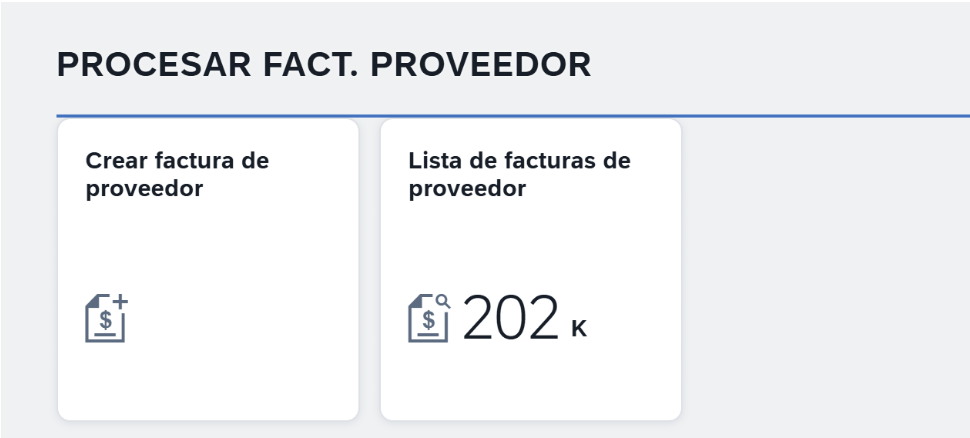

## Lo que hay que relevar antes

1. **La versión del S/4**, para filtrar en la [Fiori Apps Library](https://fioriappslibrary.hana.ondemand.com) y confirmar que la app es compatible.
2. **El catálogo** que contiene la app:

   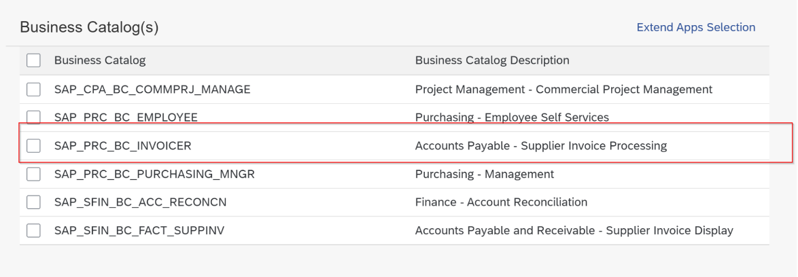

3. **El grupo** que la contiene (conviene crear uno zeta).
4. **El rol** de negocio:

   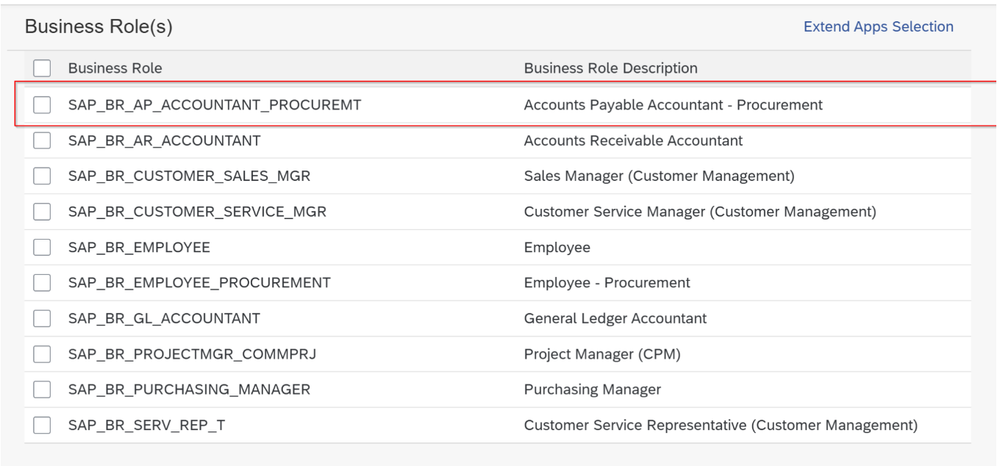

5. **Los servicios OData** a registrar/activar:

| App | Servicio OData | Intents |
|---|---|---|
| F0859 | `MM_SUPPLIER_INVOICE_MANAGE` | create, change, display, process, displayFactSheet |
| F1060A | `MM_SUPPLIER_INVOICE_LIST_SRV`, `MM_SUPPLIER_INVOICE_LIST_ENH_SRV` | list1 |

Además vas a necesitar una **OT de Workbench** y una **OT de Customizing**.

## Transacciones y programas útiles

| Transacción | Para qué |
|---|---|
| `/UI2/FLPCM_CUST` | Edición de catálogos y roles (permite copiar un catálogo entero) |
| `/UI2/FLPD_CUST` | Diseñador clásico del launchpad (catálogos y grupos) |
| `PFCG` | Roles |
| `/UI2/CDM3_EXP_SCOPE` | Exponer contenido del launchpad hacia SAP BTP |
| `/UI2/INVAL_CACHES` | Invalidar la caché de catálogos, grupos, roles y servicios del launchpad |
| `SMICM` | Ver el tráfico HTTP (descartar problemas de proxy entre el Cloud Connector y el S/4) |
| `UCONCOCKPIT` | Unified Connectivity: allowlists de RFC/HTTP |

Para los errores de caché que aparecen **cada vez que se transporta algo de Fiori** (catálogo, grupo, rol, app BSP), estos programas, **en este orden**:

1. `/UI2/DELETE_CACHE_AFTER_IMP`
2. `/UI2/PAGE_CACHE_RESET`
3. `/UI2/PAGE_CACHE_CREATE`

## SICF: servicios activos

Como mínimo, activos:

- `/sap/bc/ui2/cdm3` — la interfaz que expone el contenido del launchpad para la federación hacia BTP.
- Los OData de las apps: `MM_SUPPLIER_INVOICE_MANAGE`, `MM_SUPPLIER_INVOICE_LIST_SRV`, `MM_SUPPLIER_INVOICE_LIST_ENH_SRV`.
- Las apps (BSP) y lo que naveguen:
  - `/sap/bc/ui5_ui5/sap/mm_suppiv_mans1` (F0859)
  - `/sap/bc/ui5_ui5/sap/mm_siv_lsts1` (F1060A)
  - `/sap/bc/gui/sap/its/webgui` (navegación a MIR4 – *displayAdvanced*)

## Paso 1: catálogo y grupo zeta

No federes el catálogo estándar entero: **clonalo a uno Z y "podalo"**, dejando solo los tiles y *target mappings* que te interesan. Se puede copiar a mano desde `/UI2/FLPD_CUST` o, más rápido, con la copia directa de `/UI2/FLPCM_CUST`.

- Catálogo: `ZFI_PRC_BC_INVOICER` (copia de `SAP_PRC_BC_INVOICER`)
- Grupo: `ZFI_PRC_BCG_INVOICER` (copia de `SAP_PRC_BCG_INVOICER`)

El grupo solo lo pude crear desde `/UI2/FLPD_CUST`. Los grupos están en desuso en favor de **spaces y pages**; queda pendiente probar la federación con spaces.

## Paso 2: rol zeta

En `PFCG`, copiá el rol de negocio estándar (por ejemplo `SAP_BR_AP_ACCOUNTANT_PROCUREMT` → `ZFI:BR_AP_ACCOUNTANT_PROCUREMT`), sacale lo que no necesites e **incluí el catálogo y el grupo del paso 1**. Así no federás todo lo que el rol estándar trae embebido.

## Paso 3: UCONCOCKPIT (clickjacking)

Work Zone muestra las apps del S/4 dentro de su propio sitio, así que el S/4 tiene que permitir que lo embeban. En `UCONCOCKPIT`, escenario **HTTP Allowlist Scenario**, mirá el contexto **ClickJacking Framing Protection**:

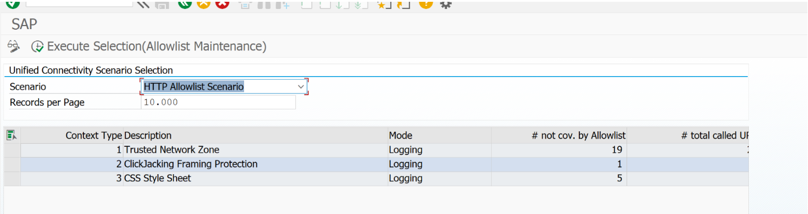

En modo **Logging** no bloquea (solo registra). Si está en un modo activo, entrá con doble clic y agregá a la allowlist la URL del sitio de Work Zone (`https://<subdominio>.launchpad.cfapps.<region>.hana.ondemand.com`).

## Paso 4: exponer el rol (`/UI2/CDM3_EXP_SCOPE`)

Ingresá el rol del paso 2 y:

1. **Visualizar** la vista previa del contenido, para ver que esté correcto.
2. **Poner a disposición** el contenido.
3. **Grabar**.

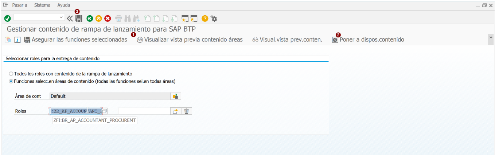

## Paso 5: rol para leer el contenido expuesto

Un rol (por ejemplo `ZS:FLP_CDM3_EXPOSURE`) con el objeto de autorización **`/UI2/FREPO`** (*File Repository*):

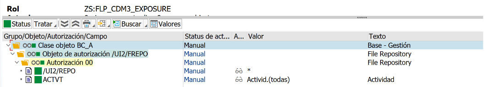

| Campo | Valor |
|---|---|
| `/UI2/REPO` | `*` |
| `ACTVT` | todas |

Generá el perfil.

## Paso 6: usuario técnico

Creá un usuario de tipo **técnico/servicio** (por ejemplo `S_FLP_EXP`) y asignale el rol del paso 5. Es el que va a usar BTP para **leer** la configuración expuesta.

Para probarlo, un GET con **Basic Auth** de ese usuario (Postman, Bruno o `curl`):

```
GET https://<host-s4>:<puerto>/sap/bc/ui2/cdm3/entities?sap-client=<mandante>
```

| Respuesta | Qué significa |
|---|---|
| **200** con un JSON de entidades (`"@odata.context": "#Entities/$entity"`, `businessapp`, …) | Todo bien. |
| **204** | Faltó exponer el rol en el paso 4 (`/UI2/CDM3_EXP_SCOPE`). |
| **403** | El rol no tiene el **perfil generado** o el usuario no está **comparado** (`PFCG` → pestaña *Usuario* → *Comparar usuario*, o en `SU01`). |

Si sigue sin funcionar: revisá el tráfico en `SMICM` y que el rol tenga bien agregados el catálogo, el grupo y las apps.

## Paso 7: dos destinations en BTP

En la subaccount donde está Work Zone, *Connectivity → Destinations*, dos destinations hacia el S/4 (vía Cloud Connector, `ProxyType: OnPremise`). **Nombres siempre en minúscula.**

**Tiempo de diseño** (`s4-hana-dt`): lo usa Work Zone para leer el contenido expuesto.

| Propiedad | Valor |
|---|---|
| URL | `http://<host-virtual>:<puerto>/sap/bc/ui2/cdm3/entities` |
| Proxy Type | `OnPremise` |
| Location ID | el de tu Cloud Connector (si tenés más de uno) |
| Authentication | `BasicAuthentication` con el usuario técnico del paso 6 |

Ojo con la URL: termina en **`/sap/bc/ui2/cdm3/entities`**. Propiedades adicionales:

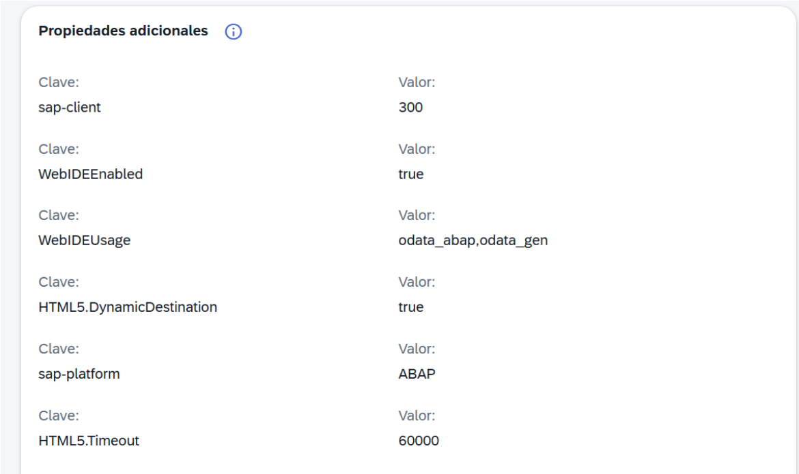

**Tiempo de ejecución** (`s4-hana-rt`): lo usan las apps al ejecutarse. Configuralo con **propagación de usuario (SSO, `PrincipalPropagation`)**, para que cada llamada llegue al gateway con el usuario real y quede trazable.

## Paso 8: proveedor de contenido en Work Zone

En el *Gestor de canales* de Work Zone → **Añadir → Proveedor de contenido remoto**:

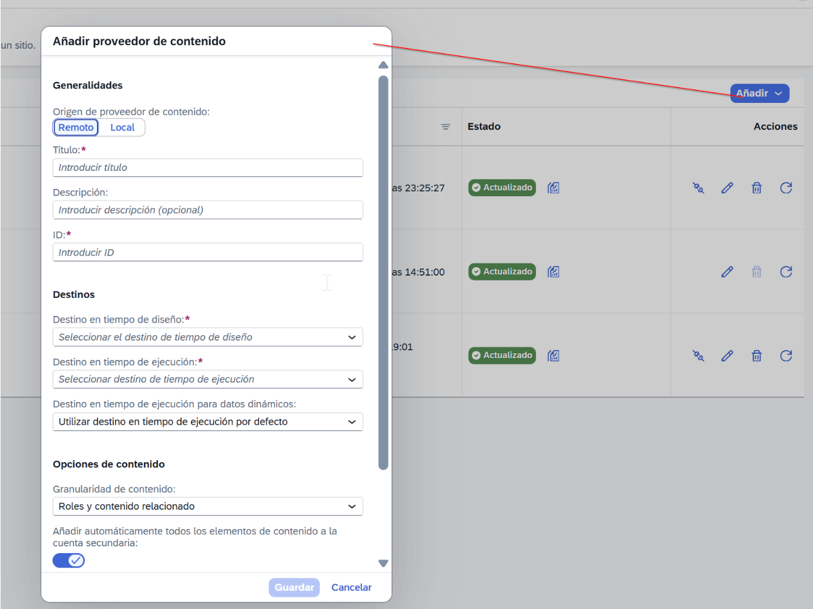

Con los dos destinations y la granularidad *Roles y contenido relacionado*:

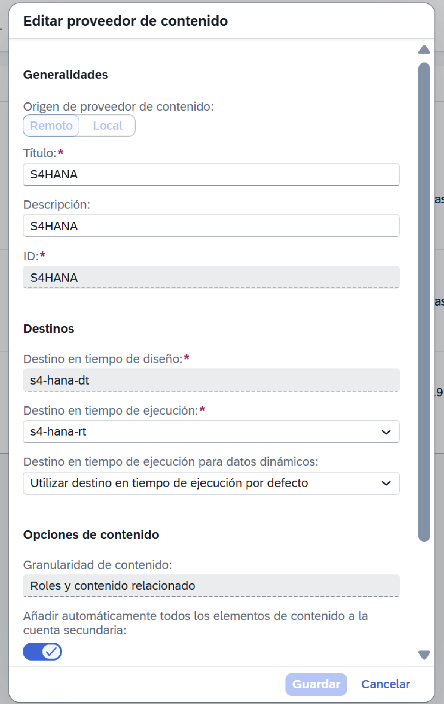

Tiene que quedar en verde (**Actualizado**):

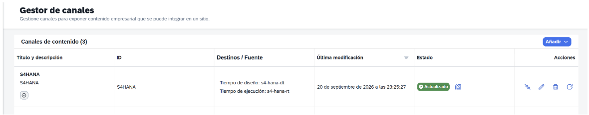

## Paso 9: asignar el rol federado

En el *Gestor de contenido* aparece el rol federado (con prefijo del canal). Agregalo a tu **sitio** y mapealo a los grupos o usuarios de BTP que correspondan:

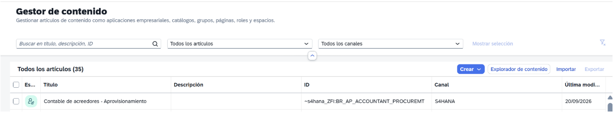

## Resumen

1. Catálogo, grupo y rol **zeta**, podados.
2. Servicios activos en **SICF** (`/sap/bc/ui2/cdm3`, OData y BSP) y allowlist de clickjacking en **UCONCOCKPIT** si aplica.
3. Rol expuesto en **`/UI2/CDM3_EXP_SCOPE`**.
4. Rol `/UI2/FREPO` + **usuario técnico**, probado contra `/sap/bc/ui2/cdm3/entities` (200 ✔, 204 ⇒ falta exponer, 403 ⇒ perfil o comparación).
5. Destinations **dt** (Basic, `/sap/bc/ui2/cdm3/entities`) y **rt** (principal propagation).
6. **Proveedor de contenido** en Work Zone y rol asignado al sitio.
7. Ante errores de caché después de transportes: `/UI2/DELETE_CACHE_AFTER_IMP` → `/UI2/PAGE_CACHE_RESET` → `/UI2/PAGE_CACHE_CREATE`.
