> Configuración realizada con estas versiones:
>
> - SAP Cloud Connector v2.17.1 Master instance
> - SAP S/4 HANA ONPREMISE v2023 Stack 01 (02/2024)
> - Cloud Foundry BTP Trial Account US East VA
>
> Los nombres de subcuentas, roles, grupos y hosts que aparecen son de ejemplo.

## 1. Cómo fluye la identidad

```
Usuario ─▶ IdP (IAS / Entra) ─▶ App en BTP (JWT con el usuario)
        ─▶ Destination (PrincipalPropagation) ─▶ Cloud Connector
        ─▶ certificado X.509 de corta vida con CN=<usuario> ─▶ ICM del ABAP
        ─▶ CERTRULE: CN → usuario SU01
```

El Cloud Connector arma, por cada request, un certificado de usuario firmado con su CA; el backend confía en el SCC como proxy inverso (RZ10) y traduce el CN del certificado a un usuario SAP (CERTRULE). Todo depende de **qué dato del usuario viaja en el CN**: ver la sección 4.

## 2. Trust Configuration IAS y BTP

Es necesario establecer la confianza a nivel **global account** (platform users) y a nivel **subcuenta** (application users).

- Los **usuarios de plataforma** se encargan de la gestión de BTP y sus servicios.
- Los **usuarios de aplicación** son los usuarios finales, por ejemplo, un usuario de una app Fiori.

Los de plataforma se generan en el IAS configurado a nivel global (el IdP de SAP), mientras que los de aplicación van sobre la relación de confianza establecida desde la subcuenta: ya sea que el proveedor sea el IAS o un IdP corporativo como Azure.

Idealmente, estos usuarios no deberían mezclarse, es decir, debería haber un usuario de plataforma distinto al usuario de aplicación, dado que al reutilizar el mismo mail se han detectado problemas de autorización en distintos servicios.

### Establecer la confianza con el IdP corporativo Azure (vía SAML 2.0)

> El detalle del lado de Entra/IAS está en la nota [Federar Entra ID con SAP IAS paso a paso](#/notas/federar-entra-id-con-sap-ias-paso-a-paso).

Una vez se ha establecido exitosamente el cruce de certificados entre Azure y el IAS (Corporate IdP de tipo *Microsoft ADFS / Entra ID (SAML 2.0)*):

1. En la subcuenta, configurar la relación de confianza para usuarios de aplicación (*Security → Trust Configuration → New SAML Trust Configuration*). Acá hay que subir el XML de metadata del IAS. Completamos los campos obligatorios, le damos guardar y nos genera la relación de confianza:

   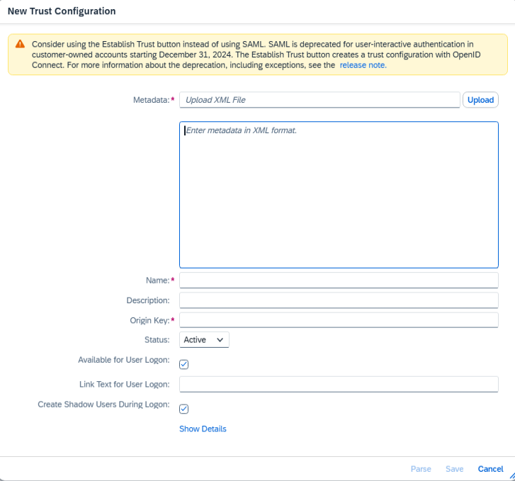

   > Ojo con el aviso de la propia pantalla: SAP deprecó el trust SAML para autenticación interactiva en cuentas de clientes desde el 31/12/2024 y recomienda **Establish Trust**, que crea la relación con OpenID Connect.

2. Selecciono la configuración y le doy a **Download SAML Metadata**.
3. Luego, desde el IAS, genero una nueva application (*Applications & Resources → Applications → Create*) e importo la metadata recién descargada (*SAML 2.0 Configuration → Browse*).
4. En la application, valido lo siguiente:
   - *Subject Name Identifier*: el atributo que identifica al usuario (ver sección 3, *Qué usuario propagar*).
   - *Attributes*: los atributos que necesite la app (por ejemplo `email` con las fuentes `${emailaddress}` / `${user.mail}` del IdP corporativo).
5. En *Conditional Authentication*, elijo como *Default Identity Provider* la configuración del IdP corporativo.

Con esto debería ser suficiente para poder loguearnos mediante las credenciales de Microsoft.

## 3. IAS

- Establecer el Trust de la subcuenta con el IAS (*Security → Trust Configuration → Establish Trust*).
- Desde el IAS damos de alta el system admin (*Users & Authorizations → Administrators → Add → System*) para conectarse vía destination desde SAP (SM59).
- Desde *Applications & Resources*, una vez tenemos el TRUST, aparecerá la Bundled App XSUAA (`SAP BTP subaccount <subcuenta>`). Desde allí podremos configurar las opciones del tenant, por ejemplo tomar el template de mail configurado, con el `applicationId` que aparece en la URL de la application.
- También debemos configurar el secret del sys admin para pegarle desde la API (*Administrators → <system> → Client Secrets → Add*). El Client ID y el Client Secret se muestran **una sola vez**: guardalos en un lugar seguro.

### Qué usuario propagar: Login Name con el user ID de SAP

Hoy la recomendación es propagar **por usuario**, no por mail: en el IAS, el campo **Login Name** de cada usuario lleva el **user ID de SAP** (el de la SU01), y eso es lo que termina en el CN del certificado.

| Propagar por | A favor | En contra |
|---|---|---|
| **Login Name = user SAP** (recomendado) | Matchea 1 a 1 con la SU01, no depende de datos personales | Hay que cargar/mantener el Login Name en el IAS (o provisionarlo) |
| Mail | No requiere carga extra si el IdP ya lo trae | Es fluctuante: puede no estar cargado, cambiar, repetirse o no coincidir con el de la SU01 |

### Grupos y role collections

Hasta acá ya tendríamos todo para pegarle vía API. Ahora necesitaremos realizar los mapeos de grupos contra las role collections generadas desde el Work Zone, por ejemplo:

| Role collection | Origen |
|---|---|
| `~<proveedor-de-contenido>_Rol_Internos` | Generada por el contenido federado en Work Zone |
| `~<proveedor-de-contenido>_Rol_Proveedor` | Generada por el contenido federado en Work Zone |
| `Rol_Internos_Apps` | Propia |
| `Rol_Proveedor_Apps` | Propia |

En el IAS gestionamos la creación de grupos (*Users & Authorizations → Groups → Create*), por ejemplo:

- `GU_PORTAL_INTERNO`
- `GU_PORTAL_PROVEEDOR`

Deberemos mapearlos contra las role collections en BTP (*Security → Role Collections → <rol> → User Groups*, Identity Provider = el tenant IAS, Name = el nombre del grupo).

Hasta acá ok con los permisos en los portales.

## 4. Cloud Connector

### Instalación y conexión

1. Bajar el SCC desde [SAP Development Tools](https://tools.hana.ondemand.com/#cloud).
2. Necesitamos tener al menos JRE v1.8 y el JDK al menos 1.8.
3. Instalar SCC; una vez instalado tenemos el acceso al mismo:

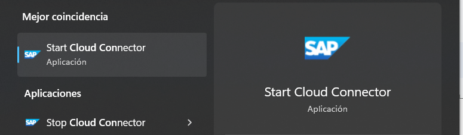

Si sale un cartelito de error, no darle importancia, porque el servicio ya está iniciado en el localhost o servidor de instalación (`https://localhost:8443`):

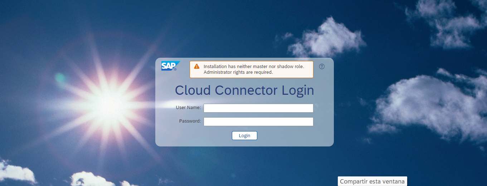

4. Ingresar con `Administrator` / `manage`, luego cambiar las credenciales.
   Si no recordamos la pass, para resetear buscar el archivo `users.xml` y setear la password `manage` nuevamente con su hash SHA-256:
   `181229424893BB65D94A74C2132B8B9E5ADFE851464FDB5CB9F49E8A8204BE7B`
5. En tipo de instalación dejar **Master** (para alta disponibilidad, ver el anexo):

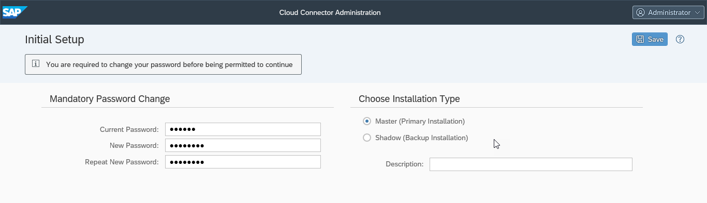

6. Una vez conectado, debo configurar la subaccount (*Add Subaccount*):

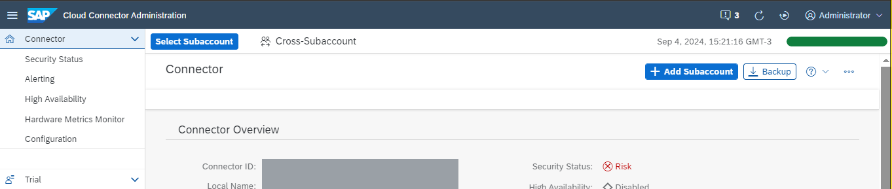

7. En los pasos de la subcuenta, el id es el de la subaccount y las credenciales son las de BTP; si no recuerdo la pass, puedo reiniciarla desde account.sap.com (o el IdP de confianza).
8. Debería quedar como alcanzable (*Connected*):

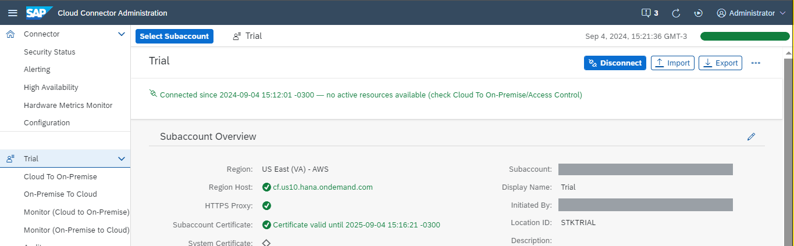

9. Entonces, se debe configurar la conexión al servidor backend (*Cloud To On-Premise → Access Control*):

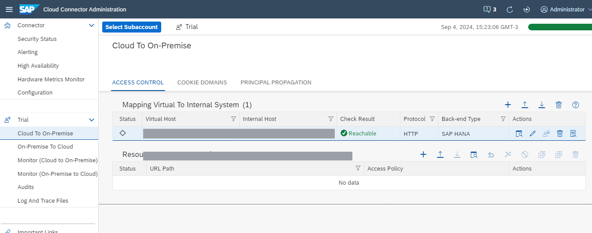

- Cuidar de tener siempre un virtual host distinto al del servidor: utilizar siempre el virtual host en lugar del físico.
- Elegir siempre la versión **HTTPS**, para habilitar la certificación X.509 (en el ejemplo se ve HTTP).

Habilitar los paths y subpaths ahí mismo:

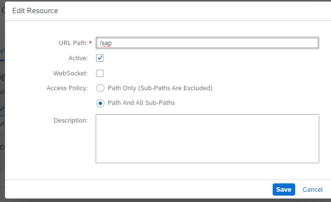

**IMPORTANTE:** en caso de que no quede alcanzable (*Not Reachable*), deberemos importar el certificado SSL correspondiente en *Connector → Configuration → On Premise → Backend Trust Store*:

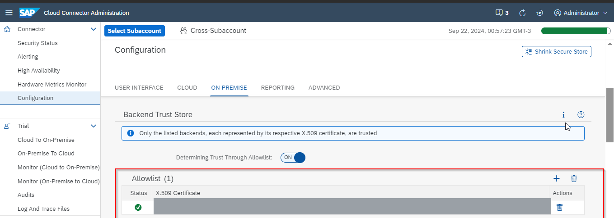

De lo contrario no se podrá alcanzar el servidor (verificar además que el certificado esté importado en el PSE *Servidor SSL Estándar* de la tcode STRUST).

PD: no hace falta agregar el servidor en el archivo hosts (`C:\Windows\System32\Drivers\etc\hosts`).

Debería aparecer *Available* en la subcuenta:

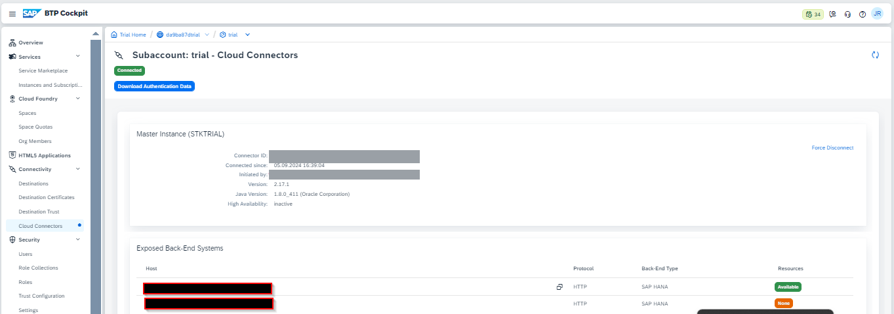

**IMPORTANTE:** también se importaron todos los certificados que solicitaba el servidor en la dirección HTTPS a nivel Cloud Connector, en la parte del Backend Trust Store. Esto solo es válido si usamos la IP externa del servidor; si estamos en el servidor local, entonces no haría falta.

### Certificados para la propagación principal

- Configurar la confianza
- Configurar el certificado CA
- Configurar la PP al sistema ABAP

Necesitamos generar estos 3 certificados:

**System certificate**

Pararse sobre *Configuration → ON PREMISE* y generar el certificado autofirmado (podría ser un certificado firmado por el cliente):

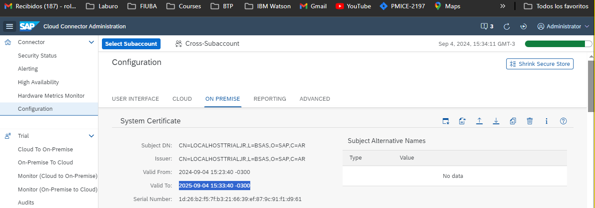

Completar los valores básicos como CN (nombre del servidor; si es para local, abrir la consola de Windows y ejecutar `hostname`, y copiar eso en este campo) y localidad. Bajarlo y tenerlo disponible para importar en SAP.

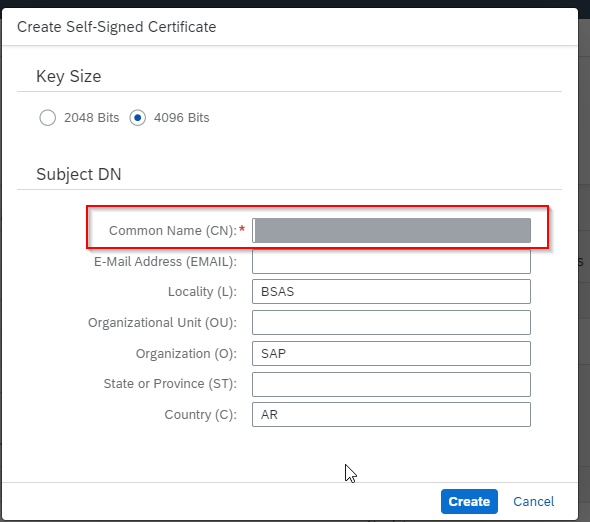

**CA certificate**

El certificado de CA se utiliza para firmar todos los certificados cuando se reenvía una solicitud desde BTP. Generar el certificado autofirmado bajo *CA Certificate*, siguiendo los mismos pasos que para el System Certificate:

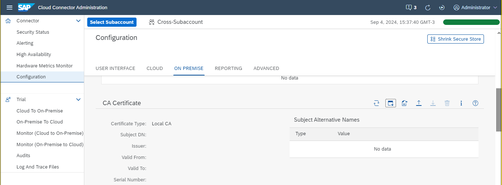

**User certificate (Subject Pattern Rules)**

Acá se define qué dato del usuario va al CN del certificado:

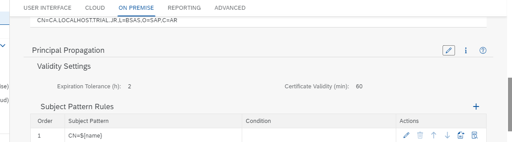

- **Recomendado:** `CN=${login_name}`, con el Login Name del IAS = user ID de SAP (sección 3).
- Alternativa: matchear contra el mail en el CN (`CN=${email}`), como en esta captura:

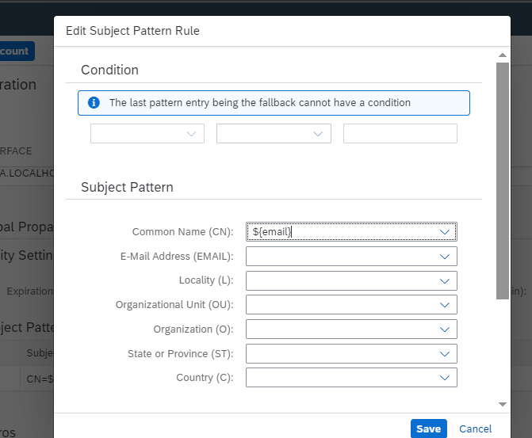

Crear un certificado de ejemplo para importar en el backend (*Create a sample certificate*), y revisar en el CN que salga el valor esperado:

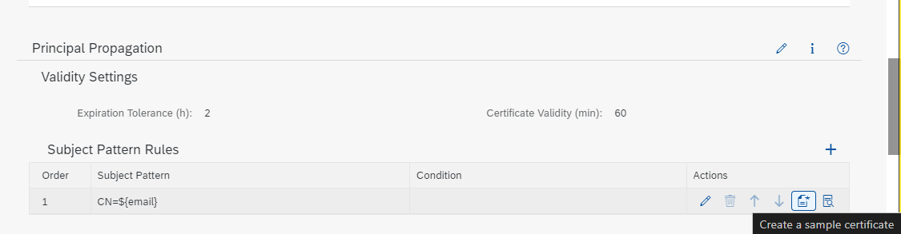

Con esto tengo los 3 certificados generados (el que nos importa para la STRUST es el de sistema; el de ejemplo se usa en la CERTRULE):

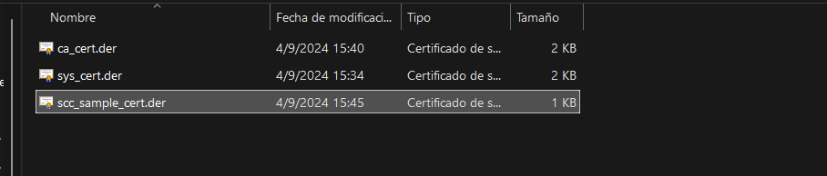

### Caso: subcuenta NEO conviviendo con Cloud Foundry

La configuración del Cloud Connector a nivel *Configuration* es cross: las Subject Pattern Rules aplican a **todas** las subcuentas conectadas. Si conviven una subcuenta **NEO** (que ya propagaba) y una **Cloud Foundry**, una sola regla no alcanza:

- En NEO, `${name}` alcanzaba.
- En CF, `${name}` no trae el usuario que necesitamos: sí o sí hay que mapear a `${login_name}` (o al mail, si se propaga por mail).

Para no romper NEO, se usan **dos reglas ordenadas**: la primera, con condición, toma `${login_name}` cuando viene en el token (CF); la segunda queda como fallback con `${name}` (NEO). La última regla es el fallback y no puede tener condición.

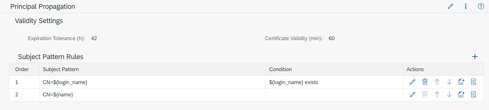

| Orden | Subject Pattern | Condition |
|---|---|---|
| 1 | `CN=${login_name}` | `${login_name} exists` |
| 2 | `CN=${name}` | *(fallback)* |

Generá un *sample certificate* para cada caso y verificá en el backend (CERTRULE) que los dos resuelvan al mismo usuario SU01.

### Logs del SCC

Es importante también revisar los logs del SCC en *Log And Trace Files*, específicamente el archivo `scc_core.trc`: nos dará información de todo lo que pasa por este middleware (si no veo la suficiente información, el nivel de log se puede configurar desde aquí tanto como se requiera):

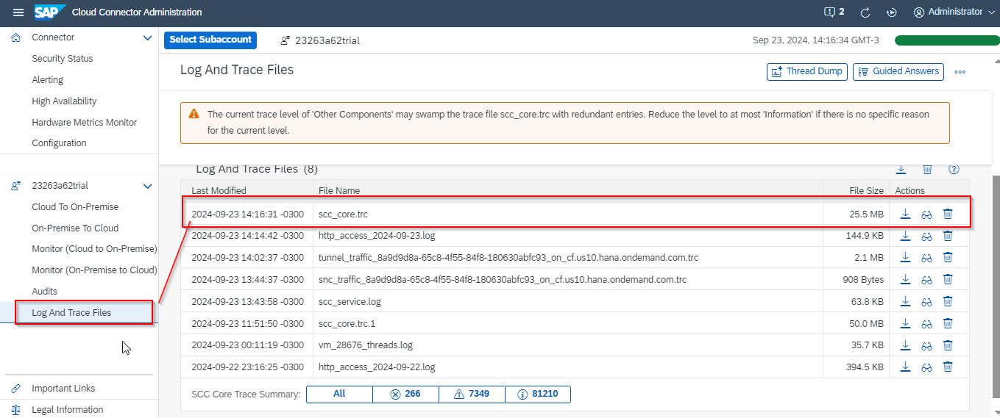

Si todavía tengo errores y no logro ver qué es, es importante revisar tanto el nodo ICM en el sistema SAP (transacción SMICM → setear log a nivel HTTP → resetear log) como la SU53 (para descartar tema de roles).

### Configurar la confianza entre el SCC y el IdP

Click en sincronizar en *Cloud To On-Premise → Principal Propagation* para autocompletar la información de confianza:

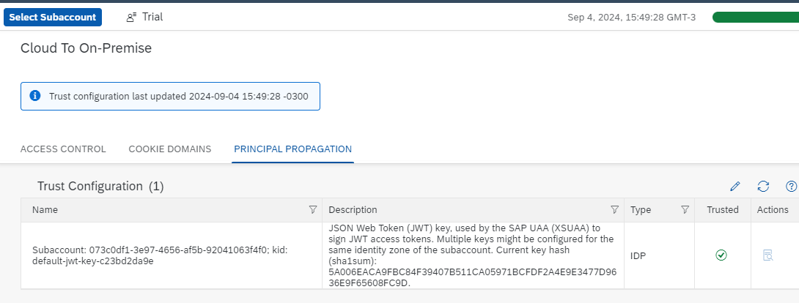

### Configurar el mapeo al backend

El último paso en Cloud Connector es cambiar la asignación HTTPS para utilizar X.509 como tipo principal.

Primero generamos el destination en la subcuenta (*Authentication = PrincipalPropagation*, *Proxy Type = OnPremise*, *Location ID* el del SCC):

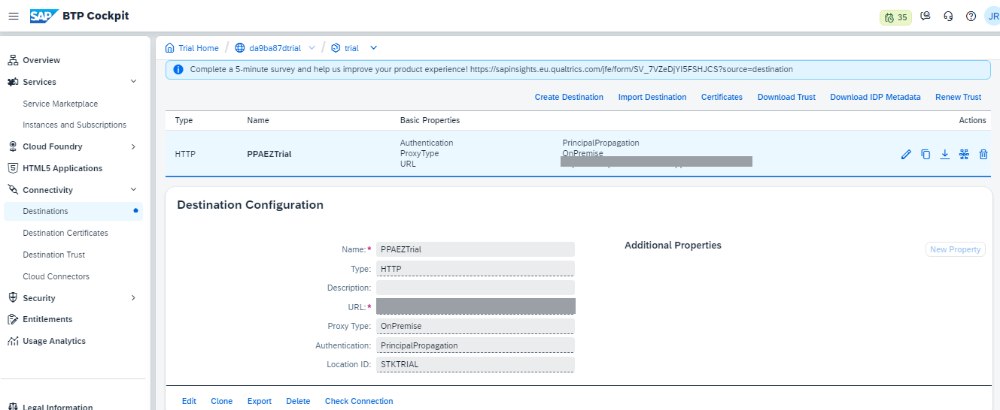

Luego, en el mapeo del sistema en el SCC (*Edit System Mapping*), deberemos elegir en **Principal Type** el certificado de tipo **X.509 Certificate (General Usage)**.

## 5. Configurar la PP en el backend ABAP

**Import the system certificate**

Se debe importar el certificado de sistema en la STRUST (PSE *Servidor SSL Estándar*):

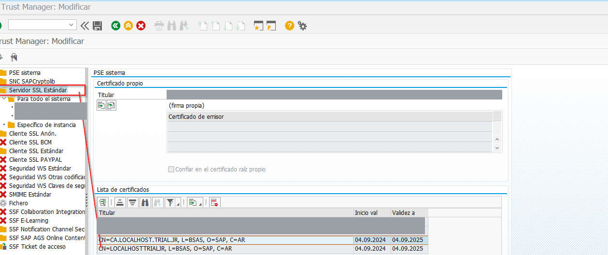

**Define rule-based mapping**

Define el mapeo entre el usuario de BTP y el usuario de la SU01. Desde la tcode **CERTRULE** importar el certificado de usuario de ejemplo y crear la regla de mapeo (*Regla*): *Entrada certificado* = Subject, *Atributo* = CN, y en *Login como*:

- **Usuario** (nombre de usuario), si el CN lleva el `${login_name}` = user ID de SAP (recomendado);
- **E-Mail**, si el CN lleva el mail (como en esta captura).

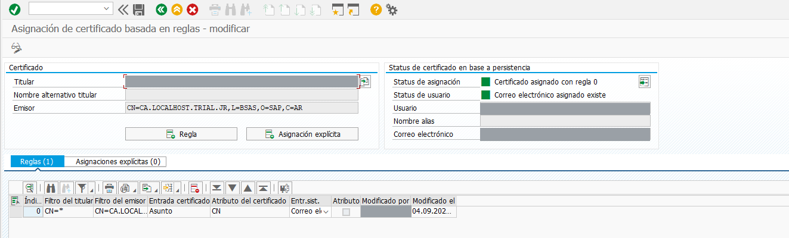

**Define RZ10 parameters**

Definir los parámetros del SCC (proxy inverso). Ir a la RZ10 y editar el perfil por default (*Actualización ampliada*):

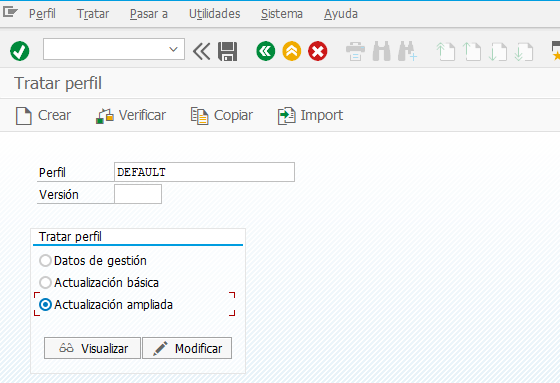

Crear los siguientes parámetros:

```
icm/HTTPS/verify_client = 1
login/certificate_mapping_rulebased = 1
icm/trusted_reverse_proxy_0 = SUBJECT="CN=<...>", ISSUER="CN=<...>"
```

En `icm/trusted_reverse_proxy_0` ajustar el último dígito en caso de que ya se use el perfil para otros escenarios.

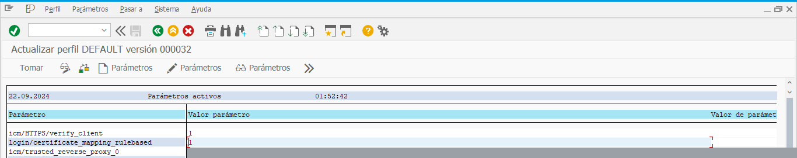

Guardar y activar el perfil.

**Reiniciar el ICM**

Desde SMICM: *Gestión → ICM → Finalizar soft → Global*, y darle OK:

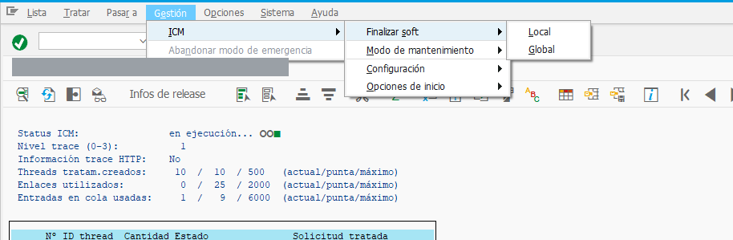

## 6. Probar

Para testear la conexión, se debería hacer desde el Work Zone mediante una aplicación Fiori que apunte a un OData cualquiera del servidor destino: debería cargar los metadatos del servicio correctamente (`$metadata` en 200):

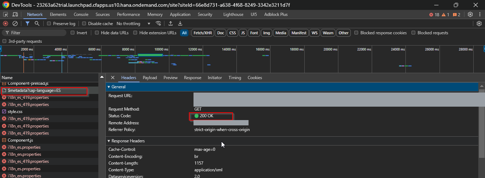

La otra opción es configurar el BAS e intentar crear un proyecto Fiori apuntando al destination de la propagación principal.

## 7. Consideraciones técnicas y troubleshooting

- La configuración del Cloud Connector a nivel *Configuration* es cross: impacta en todas las subaccounts (ver el caso NEO + CF en la sección 4).
- El parámetro a propagar desde el IAS en el JWT debería ser idealmente el **Login Name con el user ID de SAP**; el mail es la alternativa, pero es fluctuante (puede no estar cargado o cambiar). Este parámetro luego el CC lo embebe en los headers en un certificado X.509 para solicitar el token al ERP.
- **De vez en cuando la propagación deja de funcionar y se arregla con un Refresh de la conexión de la subcuenta en el SCC.** En la práctica, conviene darle *Refresh* a la subcuenta y volver a sincronizar la trust configuration (*Cloud To On-Premise → Principal Propagation → sincronizar*). Una causa probable es la rotación de las claves con las que XSUAA firma los JWT: si el SCC no tiene la clave nueva, no confía en el token. Si pasa seguido, revisalo en el `scc_core.trc`.
- Para versiones muy viejas de SAP, el parámetro `icm/trusted_reverse_proxy_0` no es válido, y se deben configurar dos adicionales:
  - `icm/HTTPS/trust_client_with_subject`
  - `icm/HTTPS/trust_client_with_issuer`

  Según la ayuda de SAP, con esos dos parámetros solo se podía configurar la relación de confianza con un único reverse proxy; `icm/trusted_reverse_proxy_<x>` es la versión vectorial que admite varios.
- El parámetro `icm/trusted_reverse_proxy_0` (el último dígito se ajusta incrementalmente si ya existía otro anteriormente) debe ser siempre:
  `SUBJECT="<contenido del SUBJECT en el certificado de sistema importado en la STRUST>", ISSUER="<contenido del ISSUER en el certificado de sistema importado en la STRUST>"`
- El matcheo de la regla en la CERTRULE es exacto: el certificado de ejemplo que se importó debe ser igual al que envía el SCC, ni un parámetro distinto ni un carácter de más en el *ISSUER filter* o *SUBJECT filter*.
- Idealmente el destination de la propagación debería estar en minúsculas: esto evitará problemas según la versión de SAP.
- El parámetro `icm/accept_forwarded_cert_via_http = TRUE` solo es requerido si la conexión al backend desde el Cloud Connector es vía HTTP; en este caso es HTTPS.
- Cada vez que configuramos el profile en la RZ10, deberemos reiniciar el servidor ABAP para que tome la configuración (es obligatorio hacerlo); luego mirar desde la RZ11 cada parámetro cambiado para ver si realmente lo tomó.
- Para guiarse en los errores, el Cloud Connector logea todo en el archivo `scc_core.trc` en la v2.17.1 (en versiones anteriores ver `ljs_trace.log`).
- A nivel ICM debemos también chequear posibles errores en la tcode SMICM, pudiendo setear el nivel de log a HTTP (para ver la entrada y salida de solicitudes de forma más amena), dependiendo la versión de SAP.

## Anexo: Cloud Connector en alta disponibilidad

Para configurar la alta disponibilidad para SAP Cloud Connector se necesitan dos SAP Cloud Connectors instalados. Después de la instalación, cuando se inicia sesión por primera vez, se pregunta si se desea configurar un sistema **Master** o **Shadow**. Seleccionar Master para el primer SAP Cloud Connector instalado y Shadow para el segundo.

Clic en el botón **Enable** (*Connector → High Availability*) para habilitar la alta disponibilidad en el SAP Cloud Connector master: esto hará que la instancia master permita la conexión desde la instancia shadow.

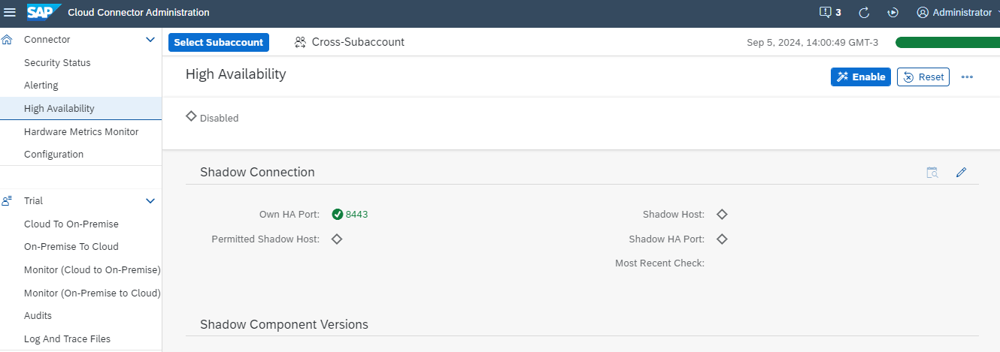

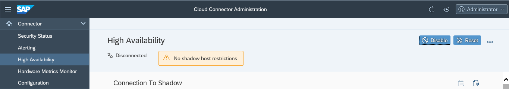

En el Shadow:

1. Iniciar sesión en el CC Shadow y hacer clic en la opción de edición de *Connection To Master* para ingresar el host de la instancia master y el número de puerto. Guardar.
2. Ahora estamos listos para conectar a la instancia master (*Connect*). Se solicitará el usuario y la contraseña de la instancia master: ingresar las credenciales y hacer clic en OK.
3. Es posible que se obtenga el error *"Cloud Connector on <host> does not respond. Check host and port and ensure that the Cloud Connector is running"* mientras se conecta desde la instancia shadow a la master. Seguir los pasos de la **SAP Note 2974161** para resolverlo.
4. Se deberían poder ver las conexiones espejadas al hacer clic en *Mirrored Subaccounts*.
5. También se puede cambiar la instancia master a la shadow haciendo clic en el botón **Switch Roles** (en el master, *High Availability*).

Las capturas de este flujo están en [el paso a paso de nineboards](https://nineboards.com/setting-up-high-availability-for-sap-cloud-connector-2-12/) y en [este video (minuto 15 en adelante)](https://www.youtube.com/watch?v=az8jfGDkuOo).

## Referencias

- Fuente: [Setting up Principal Propagation (SAP Community)](https://community.sap.com/t5/technology-blogs-by-sap/setting-up-principal-propagation/ba-p/13510251)
- Troubleshooting: [How to troubleshoot Cloud Connector principal propagation over HTTPS](https://wiki.scn.sap.com/wiki/display/ASJAVA/How+to+troubleshoot+Cloud+Connector+principal+propagation+over+HTTPS)
- Info general del SCC: [Configuring Principal Propagation (SAP Help)](https://help.sap.com/docs/connectivity/sap-btp-connectivity-cf/configuring-principal-propagation?locale=en-US)
- SCC shadow: [nineboards](https://nineboards.com/setting-up-high-availability-for-sap-cloud-connector-2-12/) · [Conectar a Cloud Connector Shadow (minuto 15 en adelante)](https://www.youtube.com/watch?v=az8jfGDkuOo)
- [Federación IAS contra Azure AD (Microsoft Learn)](https://learn.microsoft.com/es-es/entra/fundamentals/scenario-azure-first-sap-identity-integration)
