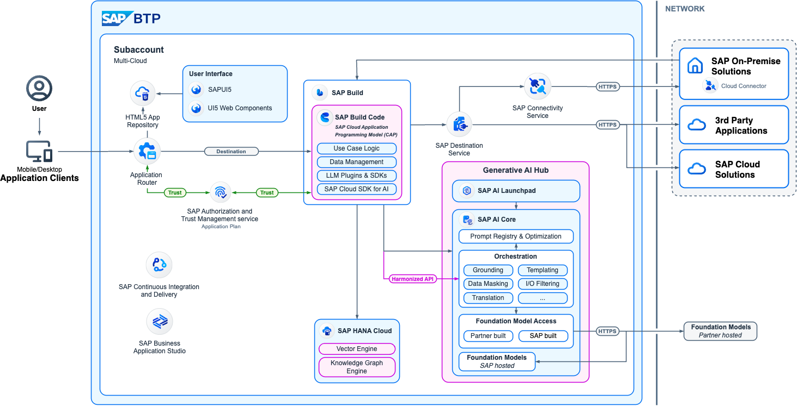

Hace poco me tocó habilitar SAP AI Core para una aplicación CAP en Node.js que lee comprobantes en PDF con un modelo de visión, extrae los datos y usa embeddings para comparar contra casos anteriores. Lo terminé haciendo en más de un ambiente, y en cada uno aprendí algo. Escribo esto para no tener que redescubrirlo la próxima vez, y por si a alguien más le ahorra una tarde.

La guía sigue el orden en que conviene hacer las cosas. Al final dejé una sección de problemas que me encontré y cómo los reconocí.

Para ubicarse, así encaja todo en la arquitectura de referencia de SAP: la app CAP llama al **Generative AI Hub** (SAP AI Core) a través del servicio de **orquestación**, que a su vez accede a los modelos de los distintos proveedores; los vectores quedan en el **vector engine de SAP HANA Cloud**.



*Diagrama: [SAP Architecture Center](https://architecture.learning.sap.com/docs/golden-path/ai-golden-path/build-and-deliver/genai-applications), © SAP SE y colaboradores de [architecture-center](https://github.com/SAP/architecture-center), licencia [Apache-2.0](https://github.com/SAP/architecture-center/blob/main/LICENSE). Recortado (sin el código QR).*

## Lo que vas a necesitar

- Una subcuenta de BTP con Cloud Foundry habilitado.
- Alguien con permisos de administrador sobre la global account (para el entitlement).
- `cf` CLI, `jq` y `curl`.
- Una app CAP que use `@sap-ai-sdk/orchestration`.

En los ejemplos uso nombres genéricos: la app se llama `mi-app`, el módulo de servicio `mi-app-srv` y la instancia de AI Core `ai-core`. Reemplazalos por los tuyos.

## 1. El entitlement, y por qué el plan importa

Esto lo hace el administrador de la global account:

BTP Cockpit → **Global Account** → *Entitlements* → *Entity Assignments* → elegir la subcuenta → *Configure Entitlements* → *Add Service Plans* → **SAP AI Core**.

El plan que necesitás es **`extended`**. Con `free` o `standard` no tenés acceso a los modelos de terceros del Generative AI Hub (Gemini, Claude, GPT, etc.). Lo peor es que nada te avisa al configurar: el problema aparece recién cuando la app intenta llamar al modelo.

Si `extended` no aparece en la lista, no está en el contrato. Ahí no hay nada técnico que hacer, hay que hablar con quien maneje la parte comercial.

Para verificar, logueado en el space:

```bash
cf marketplace -e aicore
```

Si no lista la oferta, o el entitlement todavía no se aplicó (a veces tarda unos minutos), o se asignó a otra subcuenta.

## 2. Crear la instancia

Podés crearla desde el cockpit o directamente por CLI:

```bash
cf create-service aicore extended ai-core
```

Una cosa a tener en cuenta: **la instancia vive en un space**. Si después la referenciás desde el `mta.yaml` como servicio existente, el deploy la busca solamente en el space al que estás desplegando. Me pasó de desplegar a un ambiente nuevo y recibir esto:

```
404 Service instance ai-core not found
```

La instancia existía, pero en otro space. Así que en cada ambiente nuevo, primero la instancia y después el deploy.

## 3. Bindearla a la app desde el `mta.yaml`

Si creaste la instancia a mano, declarala como servicio existente:

```yaml
resources:
  - name: mi-app-aicore
    type: org.cloudfoundry.existing-service
    parameters:
      service-name: ai-core
```

Y agregala a los `requires` del módulo de servicio:

```yaml
modules:
  - name: mi-app-srv
    type: nodejs
    path: gen/srv
    requires:
      - name: mi-app-auth
      - name: mi-app-db
      - name: mi-app-aicore
```

Si preferís que el deploy cree la instancia, usá `org.cloudfoundry.managed-service` con `service: aicore` y `service-plan: extended`. Elegí una de las dos formas: si creaste una a mano y además declarás un `managed-service` con otro nombre, terminás con dos instancias (y pagando dos).

Build, deploy y verificación:

```bash
npx mbt build -t mta_archives
cf deploy mta_archives/mi-app_1.0.0.mtar
cf env mi-app-srv | grep -A5 aicore
```

En `VCAP_SERVICES` tiene que aparecer `aicore` con `clientid`, `clientsecret`, `url` y `serviceurls.AI_API_URL`. El SDK toma las credenciales de ahí solo, así que no hay que configurar nada en el código.

## 4. Conseguir un token para hablar con la API

Para los pasos siguientes necesitás llamar a la API de AI Core. Te recomiendo sacar las credenciales con `jq` en vez de copiarlas a mano: el `clientid` suele traer un `|` y el `clientsecret` caracteres como `$` o `=`, y pegarlos en la terminal termina mal más seguido de lo que uno cree.

```bash
cf create-service-key ai-core default-key

KEY=$(cf service-key ai-core default-key | sed -n '/{/,$p')
export CLIENTID=$(echo "$KEY"     | jq -r .credentials.clientid)
export CLIENTSECRET=$(echo "$KEY" | jq -r .credentials.clientsecret)
export UAA_URL=$(echo "$KEY"      | jq -r .credentials.url)
export AI=$(echo "$KEY"           | jq -r .credentials.serviceurls.AI_API_URL)/v2

RESP=$(curl -s -X POST "$UAA_URL/oauth/token" \
  -d grant_type=client_credentials \
  -d client_id="$CLIENTID" \
  -d client_secret="$CLIENTSECRET")
TOKEN=$(echo "$RESP" | jq -r .access_token)
echo "token: ${#TOKEN} caracteres"

H="Authorization: Bearer $TOKEN"
RG="AI-Resource-Group: default"
```

El token es largo (varios miles de caracteres). Si te da 0, imprimí `$RESP` para ver el error.

Sobre el resource group: usá `default`. Es el que el SDK asume si no le decís otro. Si usás uno distinto, tenés que pasarlo explícitamente en cada cliente del código.

## 5. El deployment de orquestación (revisá antes de crearlo)

Los modelos no se llaman directamente: pasan por un deployment del escenario `orchestration`. Hace falta uno solo por resource group.

**Antes de crear nada, fijate si ya existe.** En la primera subcuenta que configuré lo tuve que crear a mano. En la segunda, unas semanas después, la instancia ya vino con una configuración `defaultOrchestrationConfig` y un deployment corriendo. Parece que el broker de AI Core empezó a provisionarlo solo. Crear otro encima es pagar dos veces por lo mismo.

```bash
curl -s "$AI/lm/deployments" -H "$H" -H "$RG" \
  | jq -r '.resources[] | "\(.id) \(.status)"'
```

Si aparece uno en `RUNNING`, saltá al paso 6. Si no:

```bash
# El escenario tiene que estar disponible
curl -s "$AI/lm/scenarios" -H "$H" -H "$RG" | jq -r '.resources[].id'

# Configuración
CONFIG=$(curl -s -X POST "$AI/lm/configurations" -H "$H" -H "$RG" \
  -H 'Content-Type: application/json' \
  -d '{"name":"mi-orchestration","executableId":"orchestration","scenarioId":"orchestration","versionId":"0.0.1"}' \
  | jq -r .id)
echo "config: $CONFIG"

# Deployment
DEPL=$(curl -s -X POST "$AI/lm/deployments" -H "$H" -H "$RG" \
  -H 'Content-Type: application/json' \
  -d "{\"configurationId\":\"$CONFIG\"}" | jq -r .id)
echo "deployment: $DEPL"

# Esperar a que arranque (unos minutos)
until curl -s "$AI/lm/deployments/$DEPL" -H "$H" -H "$RG" \
  | jq -e '.status=="RUNNING"' >/dev/null; do
  echo -n "."; sleep 20
done; echo " RUNNING"
```

Si el resource group `default` no existiera (normalmente ya viene creado):

```bash
curl -s -X POST "$AI/admin/resourceGroups" -H "$H" \
  -H 'Content-Type: application/json' -d '{"resourceGroupId":"default"}'
```

El `versionId` puede cambiar según la región. Si la configuración te lo rechaza, consultá cuáles hay:

```bash
curl -s "$AI/lm/scenarios/orchestration/versions" -H "$H" -H "$RG" | jq
```

No hace falta copiar el `deploymentUrl` al código: el SDK lo resuelve a partir del binding y el resource group.

Si preferís hacerlo con interfaz gráfica, en **SAP AI Launchpad** → *ML Operations* podés crear el mismo deployment. El resultado es idéntico.

## 6. Verificar qué modelos hay en tu región

Este paso es el que más me costó y el que más vale la pena. **El catálogo de modelos cambia según la región.** Que el SDK liste un modelo, o que esté en la documentación, no quiere decir que exista en tu subcuenta.

En mi caso, el modelo de embeddings que usaba el código no existía en la región de la subcuenta. Del resto, todos estaban.

Así se consulta:

```bash
for e in gcp-vertexai aws-bedrock azure-openai; do
  echo "== $e"
  curl -s "$AI/lm/scenarios/foundation-models/executables/$e" -H "$H" -H "$RG" \
    | jq -r '.parameters[] | select(.name=="modelName") | .description'
done
```

El detalle que me hizo perder tiempo: **los modelos disponibles están en el campo `description` del parámetro `modelName`, no en `values`**. Si hacés `jq` sobre `.values`, te devuelve vacío y parece que no hay nada.

Otras cosas que conviene saber:

- Los modelos de Anthropic van por el executable `aws-bedrock`, no tienen uno propio.
- Podés ver todos los proveedores de la región con `curl -s "$AI/lm/scenarios/foundation-models/executables" -H "$H" -H "$RG" | jq -r '.resources[].id'`.
- También se puede revisar desde AI Launchpad, en **Generative AI Hub → Model Library**.
- Si tenés varios ambientes en regiones distintas, repetí este paso en cada uno. No des por hecho que el resultado de uno vale para otro.

## 7. No dejes los nombres de los modelos fijos en el código

Los modelos se dan de baja más rápido de lo que uno espera. Me pasó con uno que usaba para análisis de texto: de un día para el otro la app empezó a fallar con un error que no decía nada útil, y recién en los logs apareció esto:

```
400 - LLM Module: This model version has reached the end of its life
```

Desde entonces leo los modelos de variables de entorno, con un valor por defecto en el código:

```js
const MODEL_VISION    = process.env.AI_MODEL_VISION    || 'gemini-x-flash';
const MODEL_TEXT      = process.env.AI_MODEL_TEXT      || 'anthropic--claude-x-sonnet';
const MODEL_EMBEDDING = process.env.AI_MODEL_EMBEDDING || 'text-embedding-ada-002';
```

Y las declaro en el `mta.yaml`:

```yaml
  - name: mi-app-srv
    properties:
      AI_MODEL_VISION: gemini-x-flash
      AI_MODEL_TEXT: anthropic--claude-x-sonnet
      AI_MODEL_EMBEDDING: text-embedding-ada-002
```

(Los nombres de arriba son ilustrativos. Usá los que hayas confirmado en el paso 6.)

Cuando un modelo se da de baja, lo podés cambiar sin redeploy:

```bash
cf set-env mi-app-srv AI_MODEL_TEXT <modelo-nuevo>
cf restart mi-app-srv
```

Pero ojo: **en el próximo deploy del `.mtar`, los valores del `mta.yaml` pisan los del entorno.** Si no actualizás también el `mta.yaml`, el cambio se pierde y vuelve el modelo viejo.

## 8. Cambiar de modelo no es solo cambiar el nombre

Algunas cosas que aprendí al reemplazar modelos:

- **Formato de respuesta.** Si usás `response_format: json_schema` con schema estricto, no todos los modelos lo soportan. Los de Anthropic vía BTP, en mi experiencia, solo aceptaban `json_object`. Cambiar de familia puede obligarte a cambiar cómo forzás la respuesta en JSON.
- **Prompts.** Un prompt ajustado para un modelo no rinde igual en otro. Después de cambiar, probá con documentos cuyo resultado ya conozcas y compará.
- **Embeddings y dimensiones.** La cantidad de dimensiones del modelo de embeddings está atada a tu schema. Si en CDS tenés `Vector(1536)`, necesitás un modelo que devuelva 1536. `text-embedding-ada-002` lo hace de forma nativa. Otros, como `text-embedding-3-large`, devuelven más pero aceptan un parámetro `dimensions` para reducirlo, si el SDK lo expone. Cambiar de dimensión implica cambiar el schema y regenerar todos los vectores guardados.

## 9. Embeddings: no hace falta otro deployment

Si usás `OrchestrationEmbeddingClient` del SDK de orquestación, los embeddings van por el mismo deployment de orquestación. No necesitás un deployment aparte del escenario `foundation-models`.

Un error que tuve y que me costó encontrar: le pasaba al cliente `{ embedding: ... }` (singular) y el SDK espera `{ embeddings: ... }` (plural). Como el código atrapaba el error y seguía sin embeddings, durante un buen tiempo esa parte nunca funcionó y nadie lo notó. Lo que me deja eso: si tu código falla en silencio a propósito (está bien que lo haga, para no romper el flujo principal), **que no haya errores no quiere decir que funcione.** Verificá que la tabla de vectores efectivamente crezca.

## 10. Si guardás vectores en HANA Cloud

Confirmá que la columna quedó con el tipo correcto:

```sql
SELECT COLUMN_NAME, DATA_TYPE_NAME
  FROM TABLE_COLUMNS
 WHERE TABLE_NAME = '<TU_TABLA_DE_EMBEDDINGS>'
   AND COLUMN_NAME = '<TU_COLUMNA_VECTOR>';
```

Tiene que devolver `REAL_VECTOR`. El vector engine es parte del core de HANA Cloud, así que debería estar aunque hayas bajado de plan o apagado servicios opcionales. Igual, chequearlo lleva 30 segundos.

## 11. Probar de punta a punta

Con todo lo anterior listo, usá la app como lo haría un usuario (en mi caso, subir un PDF real) y mirá los logs:

```bash
cf logs mi-app-srv --recent | grep -iE "orchestration|embedding|LLM Module"
```

Lo que esperás ver: la llamada al modelo, la respuesta procesada y, si usás embeddings, un insert en la tabla de vectores.

## 12. Desarrollo local

Para probar sin desplegar, el SDK acepta la service key por variable de entorno:

```bash
cf create-service-key ai-core sk-local
cf service-key ai-core sk-local
export AICORE_SERVICE_KEY='<el JSON completo de la key>'
npx cds watch
```

## 13. Rotá las credenciales cuando termines

Mientras debuggeás es muy fácil que un `clientsecret` termine en una terminal compartida, en un chat o en un log. Antes de pasar a productivo, rotalos:

- Service key: `cf delete-service-key` y después `cf create-service-key`.
- Binding de la app: `cf unbind-service`, `cf bind-service` y `cf restage`.

## Problemas que me encontré y cómo reconocerlos

| Lo que ves | Lo que suele ser |
|---|---|
| `cf marketplace` no muestra `aicore` | Falta el entitlement, o se asignó a otra subcuenta |
| La app llama al modelo y falla aunque todo parece bien configurado | El plan no es `extended` |
| `404 Service instance ... not found` en el deploy | La instancia está en otro space |
| `jq` sobre `.values` no devuelve modelos | Están en `description` del parámetro `modelName` |
| Error opaco ("status code undefined", 409) al llamar al modelo | Mirá `cf logs`: casi siempre es un modelo dado de baja |
| Cambiaste el modelo con `set-env` y volvió el viejo | El deploy del `.mtar` pisó la variable con el valor del `mta.yaml` |
| Los embeddings "andan" pero la tabla no crece | Error atrapado en silencio; revisá la forma del request al SDK |
| El token sale vacío | Credenciales mal copiadas; sacalas con `jq` e imprimí la respuesta del UAA |

## Checklist para un ambiente nuevo

1. Entitlement con plan `extended` en la subcuenta.
2. Instancia de AI Core creada en el space correcto.
3. Recurso declarado en `mta.yaml` y agregado a los `requires` del módulo de servicio.
4. Deploy y verificación del binding en `VCAP_SERVICES`.
5. Revisar si ya existe un deployment de orquestación; crearlo solo si no hay.
6. Verificar los modelos disponibles **en esa región**.
7. Ajustar las variables de modelos en `mta.yaml` si alguno no está.
8. Confirmar el tipo `REAL_VECTOR` si usás HANA para embeddings.
9. Prueba real de punta a punta mirando los logs.
10. Rotar las credenciales que se hayan expuesto.
