> Armado sobre una cuenta **trial** (setup de punta a punta) y sobre la experiencia en un proyecto real con Azure Repos (flujo de ramas y consideraciones). Los nombres de repos, spaces y usuarios son de ejemplo.

## 1. La foto completa

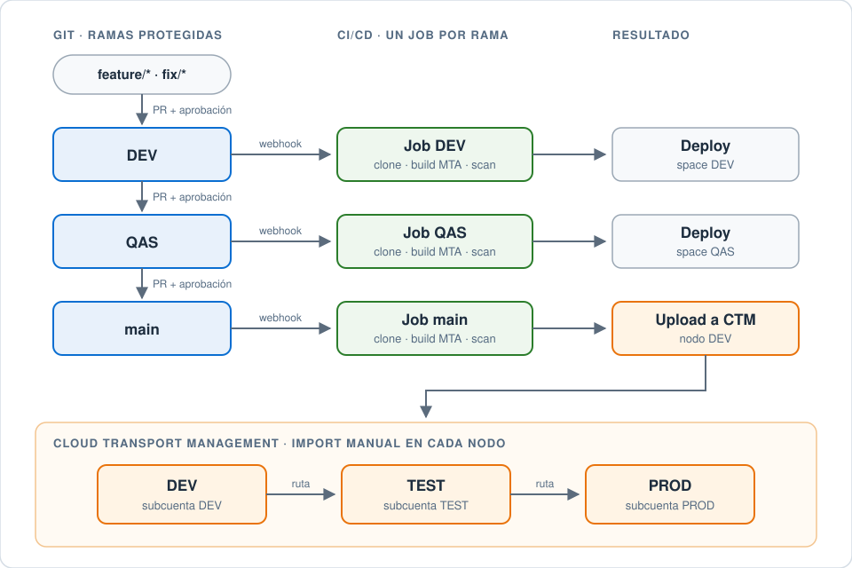

| Pieza | Para qué |
|---|---|
| **Git** (Azure Repos, Bitbucket, GitHub…) | Código, ramas protegidas, Pull Requests con aprobación, webhooks |
| **SAP Continuous Integration and Delivery (CI/CD)** | Jobs que clonan, buildean (MTA), testean, escanean y despliegan |
| **SAP Cloud Transport Management (CTM)** | Mueve el `.mtar` entre subcuentas (nodos y rutas), con import controlado |
| **SAP Cloud ALM** (opcional) | Ver y operar los transportes de CTM desde ALM |
| **Alert Notification** | Mails cuando CI/CD buildea o CTM despliega |

### Prerrequisitos

1. App de prueba buildeable con MTA.
2. Cuenta de Git, en algún proveedor de preferencia, para configurar el webhook.
3. SAP CI/CD: para la configuración del job.
4. SAP CTM: para el deployment automatizado entre subaccounts. Más integración desde SAP Cloud ALM.
5. Alert Notification: para la notificación vía e-mail desde CTM o CI/CD.
6. Tener un landscape de al menos dos subaccounts para probar (DEV y TEST).

## 2. Flujo de ramas propuesto

### Desarrollo

El desarrollador implementa su solución en BTP y crea una rama `feature/<>` o `fix/<>` dependiendo del contexto.

Una vez que quiere subir sus cambios a desarrollo, genera el Pull Request que apunta de su rama `feature/<>` o `fix/<>` hacia la rama `DEV` (o `dev`, dependiendo el repositorio).

Ese Pull Request no debería poder aprobarlo el mismo desarrollador, sino que debería venir otro con permisos de aprobación y "Completar el Merge". Una vez completo el merge, se dispara un webhook que le pega a CI/CD, específicamente al job de la rama DEV. Este job clona el repositorio desde la rama DEV, compila la aplicación y la sube al space de desarrollo.

> La rama DEV debe estar protegida contra escritura directa.

### Calidad

Una vez probado el desarrollo subido a BTP en el space de desarrollo, se quiere pasar a calidad: para eso se debería armar un Pull Request desde la rama DEV hacia la rama QAS. Lo mismo para la aprobación: debería otro desarrollador con permisos de review aprobar y mergear ese PR, para que al finalizar el merge se dispare un webhook hacia el job de la rama QAS en CI/CD. Luego, es igual: este job clona el repositorio desde la rama QAS, compila la aplicación y la sube al space de calidad.

> La rama QAS debe estar protegida contra escritura directa.

### Productivo

Para pasar a productivo, el Pull Request debe hacerse desde la rama QAS a `main`, misma lógica de aprobación: aprueba alguien con permisos de merge en `main`, distinto a quien creó el Pull Request.

Una vez que se completa el merge hacia `main`, se dispara un webhook que le pega al job de `main` en CI/CD, que a su vez clona la aplicación, la compila y la sube a **Cloud Transport Management** en el nodo DEV. Una vez en el nodo DEV, se deberá importar manualmente en las subcuentas de calidad y productivo desde CTM, sobreescribiendo así con la versión estable los tres ambientes.

### Reglas de las ramas

- Tres ramas fijas por repositorio: `DEV`, `QAS` y `main` (si no existen, crearlas).
- Cada rama bloqueada contra commits directos: solo se actualiza mergeando un Pull Request con **al menos 1 aprobador distinto al creador**.
- Un webhook (service hook) por rama, cada uno apuntando a su job de CI/CD.

## 3. CI/CD

### Suscripción y roles

| Role collection | Descripción |
|---|---|
| `CICD Service Administrator` | Administrator Role Collection for the Continuous Integration & Delivery Service |
| `CICD Service Developer` | Developer Role Collection for the Continuous Integration & Delivery Service |

Debo contratar la suscripción al servicio y, luego de asignadas las role collections, ir al servicio.

### Credenciales

CI/CD usa cuatro tipos de credenciales. Con una de cada una alcanza para todos los repositorios:

| Credencial | Tipo en CI/CD | Para qué |
|---|---|---|
| Git | Basic Authentication | Clonar el repo (con Azure Repos: *Clone → Generate Git Credentials*) |
| Webhook | Webhook Secret | Que el proveedor de Git se autentique contra CI/CD |
| BTP | Basic Authentication | Deploy al space de Cloud Foundry (usuario técnico, ver sección 6) |
| CTM | Service Key | Subir el `.mtar` a CTM (el JSON de la service key de la instancia de CTM) |

Se recomienda generar un **usuario técnico o de servicio** para Git y BTP, para evitar cambios en las credenciales cuando alguien se va o cambia su password.

Credencial de deploy a BTP:

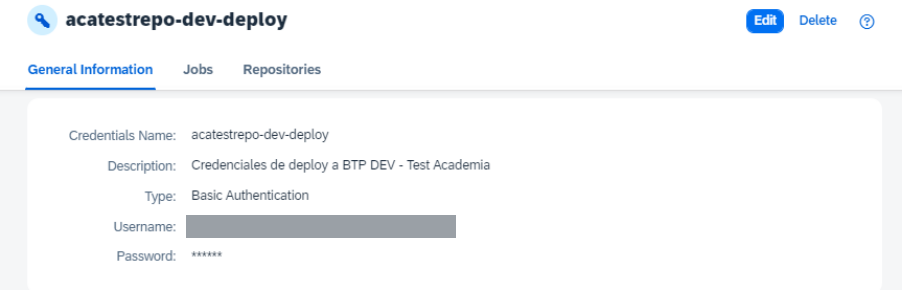

### Repositorio

Configurar el repositorio en CI/CD (*Repositories → Add*): URL de clonación y la credencial de Git. Con Bitbucket Cloud, además pide el **UUID** del repo.

Cada repositorio dado de alta tiene su **Webhook Data**: la URL a la que le va a pegar el webhook desde el proveedor de Git. La URL varía por repositorio.

### Job

Luego queda configurar el job, que dependerá de lo que queramos que realice:

- **Build Tool:** siempre `mta` para Fiori, con la última versión de Java.
- **Lint Check:** no lo prendemos, a menos que necesitemos evitar el build o deploy en caso de errores.
- **Additional Unit Tests:** si estamos laburando con tests automatizados, podemos prender esa opción.
- **Malware Scan:** va siempre.
- **Acceptance:** ahora CF pide que esté prendido. Completar los datos de la subaccount destino y seleccionar la credencial de deploy:

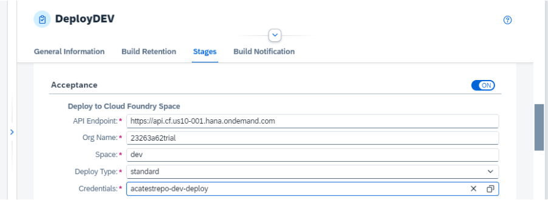

- **Release:** como ya completamos Acceptance, no haría falta un doble despliegue, con lo cual dejamos *Deploy to Cloud Foundry Space* del Release en blanco:

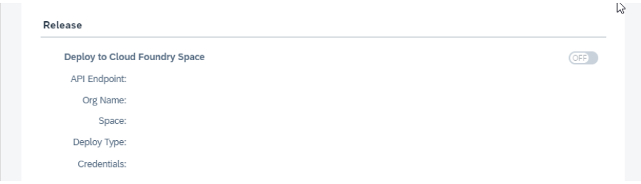

Un job por rama: el de DEV y el de QAS despliegan directo a su space; el de `main` no despliega, sube a CTM.

### Agregar CTM al job

1. Voy a la instancia de CTM, busco la service key y copio el JSON.
2. Voy a CI/CD y creo las credenciales de tipo **Service Key** con ese JSON:

   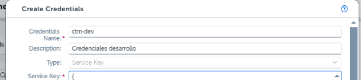

3. Configuro el paso de CTM en el Release del job: *Cloud Transport Management* = ON, *Transport Operation* = **Upload to**, nodo = `DEV` (el nombre del nodo en CTM), *Service Key* = la credencial anterior.
4. Una vez que se ejecutó el job en CI/CD, vemos que en CTM queda (dependiendo el forward mode) el deploy realizado o no en la subcuenta. Con el nodo DEV en *pre-import*, se agregó la solicitud a la cola de transporte y el import es manual.

## 4. Git: webhooks

### Bitbucket Cloud

En el repo, *Repository settings → Webhooks → Add webhook*, y pegar la URL del Webhook Data generada en CI/CD. También se puede generar un secret (guardarlo); en este caso CI/CD no lo necesitó, le bastó con las credenciales y el UUID del repositorio.

En el webhook seleccionamos qué acciones lanzarán el job. Idealmente, dos webhooks:

- **Pull Request updated:** si tenemos el PR abierto, cada vez que se actualice, sube los cambios a testing. Debería apuntar a un job que solo haga el upload a QAS.
- **Pull Request merged:** cada vez que el PR se mergea a la rama destino, se activa el job de productivo, que a su vez activa el deploy por CTM.

En el proveedor de Git se puede ver el historial de requests al CI/CD (headers y body), útil para depurar.

### Azure Repos

*Project Settings → Service hooks* → **SAP**:

- Tres service hooks por repositorio, uno por cada rama (DEV, QAS y `main`).
- El evento a seleccionar en cada caso es **Code pushed** (el merge de un PR es un push a la rama).
- Cada hook apunta a la URL del Webhook Data del repositorio en CI/CD.
- Usuario y contraseña: los de la credencial de tipo Webhook Secret de CI/CD (*Webhook client id* = `TOKEN`, *Webhook secret* = el secret generado). Son únicos para todos los webhooks.

Después, testear la conexión desde el mismo service hook (*Test*): tiene que responder OK y verse el request en CI/CD.

> El webhook secret es una credencial: no lo pegues en documentación ni en tickets.

## 5. Primera corrida

Desde BAS clono el repositorio, armo la rama del job (en este caso `develop`), hago un cambio de prueba y el push:

```sh
git clone <url-del-repo>
git checkout develop
git add .
git commit -m "cambio de prueba para tutorial CI/CD"
git push origin develop
```

En CI/CD veremos el build del job, y luego de un tiempo la ejecución exitosa o fallida (pudiendo ingresar paso por paso para revisar qué falló):

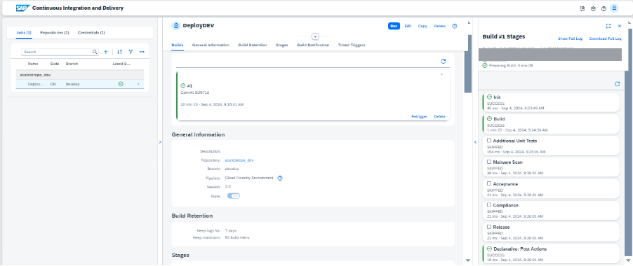

Con el paso Acceptance en verde:

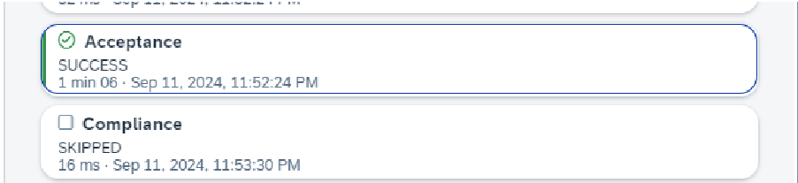

y en BTP la app desplegada (*Instances and Subscriptions* del space).

## 6. Usuarios técnicos para el deploy

### Deploy directo a BTP desde CI/CD

Se debe configurar un usuario técnico en el IAS, con rol **Space Developer** en cada space al que despliega CI/CD.

**IMPORTANTE:** este usuario no debe utilizarse para otra cosa que no sea el deploy. Si la cuenta tiene un IdP corporativo (por ejemplo Azure), más un IAS configurado como IdP de plataforma (`<tenant>-platform`), más la opción de `sap.ids` (el usuario creado en account.sap.com), al momento de utilizar el mismo mail para dos usuarios de distinto IdP, SAP se confunde y arroja **401** de autenticación.

En la credencial de CI/CD, el **Origin Key** hace referencia al tenant de plataforma del IAS (`<tenant>-platform`), el que se generó al establecer el trust a nivel cuenta global.

También se podría utilizar un usuario registrado en el IdP de account.sap.com (el Default Identity Provider): no recomendado.

### Creación del usuario con mail ficticio

Desde el IAS (*Users & Authorizations → User Management → Add*), al crearlo seleccionamos **Set initial password**, y luego desde las opciones del usuario seteamos *Status Mail Active*. Después intentamos loguearnos desde la URL del IAS para cambiar esa password inicial. Finalmente, una vez cambiada, ya estamos en condiciones de utilizarlo.

## 7. Cloud Transport Management

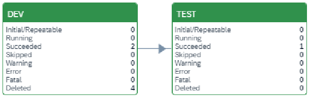

### Roles

| Role collection | Descripción |
|---|---|
| `TMS_LandscapeOperator_RC` | Contains TMS LandscapeOperator role |
| `TMS_Viewer_RC` | Contains TMS Viewer role |

CTM conviene tenerlo en una subcuenta propia (por ejemplo `CTS`), separada de DEV/QAS/PRD: ahí viven la instancia, sus destinations y la service key que usa CI/CD.

Esas role collections son las básicas, pero no cubren la importación y exportación: si intentás importar solo con ellas, CTM avisa que falta un permiso. Para eso hay que generar una role collection custom (por ejemplo `ZAdministrator-CTM`) con los roles *Administrator*, *ExportOperator* e *ImportOperator* de la instancia de CTM, y asignarla al usuario.

### Destinations de deploy

Cada nodo apunta a una subcuenta a través de un destination (en la subcuenta de CTM), uno por cada subcuenta a la que se quiera desplegar. La URL tiene este formato:

```
https://deploy-service.cf.<región>.hana.ondemand.com/slprot/<org name>/<space name>/slp
```

Por ejemplo, con API endpoint `https://api.cf.us10-001.hana.ondemand.com`, org `23263a62trial` y space `dev`:

```
https://deploy-service.cf.us10-001.hana.ondemand.com/slprot/23263a62trial/dev/slp
```

**IMPORTANTE:** existe también la variante de URL con el GUID del space en lugar de org/space, pero en mi caso devolvió error de permisos: usá la de nombres.

Ejemplo con autenticación básica (usuarios de `sap.ids`):

| Campo | Valor |
|---|---|
| Proxy Type | Internet |
| Authentication | BasicAuthentication (solo para `sap.ids`) |
| User | mail del usuario de `sap.ids` usado para el deploy |
| Password | su contraseña |

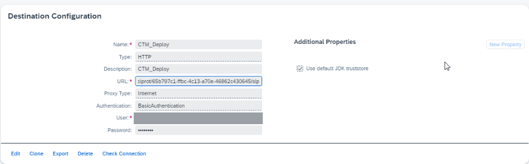

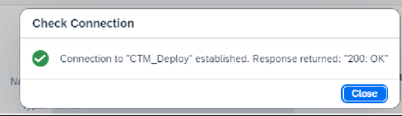

#### IMPORTANTE: utilizar OAuth2Password

Debería utilizarse un **usuario técnico de plataforma** sobre el destination, entonces la autenticación debería ser de tipo **OAuth2Password**, tal cual lo expone el manual de configuración (sección *Creating Destinations Using SAP Cloud Deployment Service with OAuth2Password Authentication* en help.sap.com). Básicamente, si el IdP es el IAS, dar de alta un usuario técnico y darle permisos para importar al nodo correspondiente.

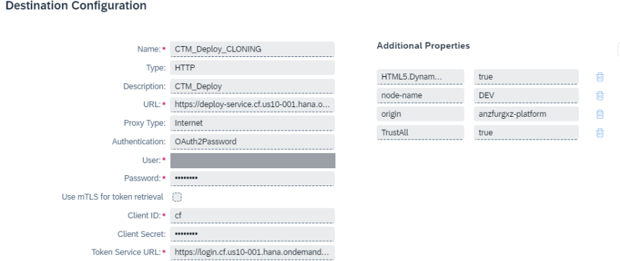

| Campo | Valor |
|---|---|
| Authentication | OAuth2Password |
| User / Password | usuario técnico de plataforma |
| Client ID | `cf` |
| Client Secret | vacío |
| Token Service URL | `https://login.cf.<región>.hana.ondemand.com/oauth/token` |
| Propiedad `origin` | `<tenant>-platform` (el origin del IAS de plataforma) |

El *Check Connection* no es posible para este tipo de destino y puede devolver un error aún cuando esté correctamente configurado: para probar, hacerlo directamente desde un transporte.

> El usuario técnico del destination **no puede tener MFA**: el pedido de token falla con 401 y el deploy no arranca (SAP KBA 3766638).

**¿Por qué no dejar la autenticación básica?** La autenticación básica es solo para el Default Identity Provider, y SAP recomienda implementar nuestro propio tenant con nuestro IdP de preferencia. Además, si la cuenta tiene varios IdPs vinculados, al importar devuelve: `error creating client id: Forbidden`.

### Nodos

Desde CTM configuramos cada nodo del landscape, comenzando por el de desarrollo:

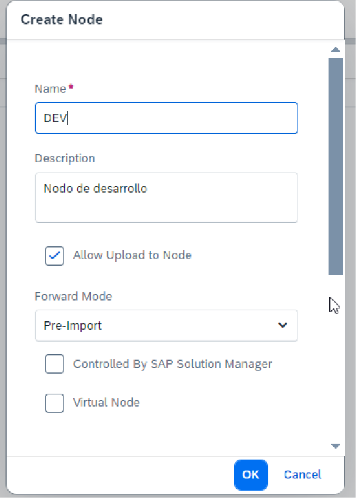

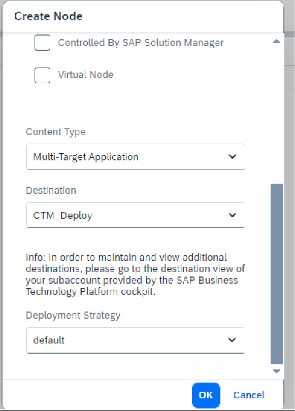

- **Allow Upload to Node:** en el nodo de entrada (DEV), para que CI/CD pueda subir.
- **Content Type:** Multi-Target Application.
- **Destination:** el de deploy a la subcuenta de ese nodo.

**Forward Mode** puede variar dependiendo de lo que queramos. *Pre-Import*, que viene por defecto, reenvía la solicitud de transporte a los nodos destino de la ruta para que quede pendiente de importación, antes de que se importe en este nodo raíz.

> **IMPORTANTE: Forward Mode**
> - En DEV, **On Success**, para habilitar la copia automática a TEST.
> - En TEST, **On Success**, para habilitar la copia automática a PROD.
>
> La subida al nodo será automática, pero no se importará a menos que se haga manualmente.

Luego seguimos con TEST (y PROD) de la misma forma, cada uno con su destination.

### Ruta

Creamos una ruta de transporte desde desarrollo a testing (esto también se puede generar con el *Landscape Wizard*):

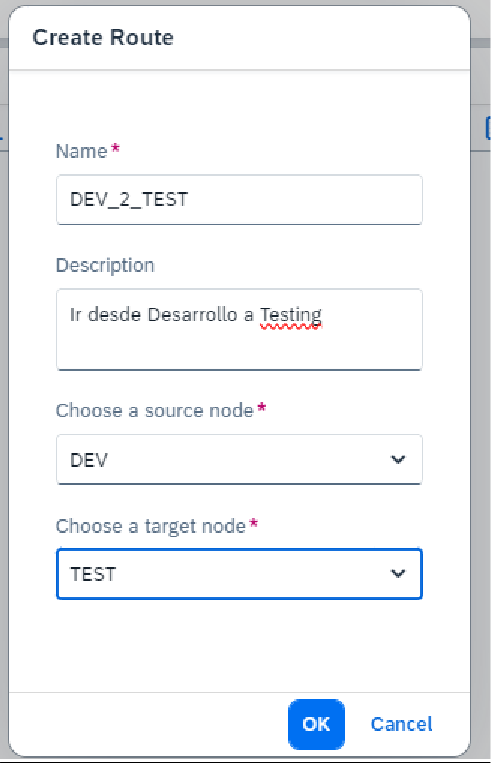

### Import

Una vez que CI/CD desplegó la app y subió el `.mtar` al nodo DEV de CTM, deberíamos ver el transporte en estado *Initial*. Con **Import Selected** comienza la importación a la subcuenta y el posterior reenvío de la solicitud al nodo siguiente (TEST). Debería quedar en *Succeeded*, y en el nodo destino queda pendiente el import:

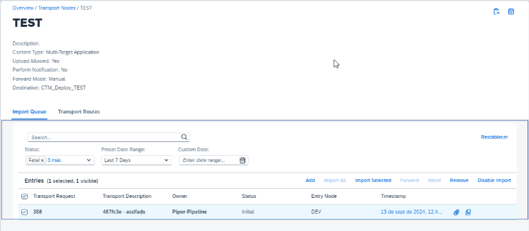

Si configuramos correctamente el destination, al darle import queda en *Succeeded* en los dos nodos.

### CTM desde Cloud ALM

El manejo de la conexión debe realizarse desde ALM, y no desde la API de CTM: hay que tomar el destination allí expuesto para integrar contra otros servicios vía API.

1. Activar el entitlement de Cloud ALM.
2. Conectar ALM con CTM (destination con prefijo `CALM_PTR_CTMS` en la subcuenta de CTM).
3. Los transportes aparecen en la herramienta *Features* de ALM.

> No mantener dos destinations apuntando a la misma instancia de CTM, para evitar duplicidad de archivos.

## 8. Alert Notification

Debo tener la instancia creada y luego ingresar a su cockpit (*Instances and Subscriptions → alert → Manage*).

1. **Action** de tipo **Email**, con la dirección destino y, opcionalmente, un asunto y un template HTML. Llega un mail de confirmación: hay que seguir el link para que quede operativa.
2. **Condition:** cuando la categoría incluya `NOTIFICATION` (*Condition*: `category` *Contains* `NOTIFICATION`). Adicionalmente se puede configurar otra que matchee la categoría `EXCEPTION`.
3. **Subscription:** une la action y la condition.
4. **Probar:** desde la subscription, *Send Test Event*, cambiando la categoría del JSON de ejemplo a `NOTIFICATION` para que tome la condición. Tiene que llegar el mail.

### Notificación desde CI/CD ante un nuevo build

1. Generar el destination que expone la documentación de CI/CD para Alert Notification.
2. En CI/CD, *Credentials*: credencial de tipo **Service Key** con el JSON de la service key de la API de Alert Notification.
3. Asignarla en el job, *Build Notification → Send Build Notifications via SAP Alert Notification*.

### Notificación desde CTM ante un nuevo deploy

Además de la configuración del destination, marcar **Perform Notification** en el nodo en cuestión:

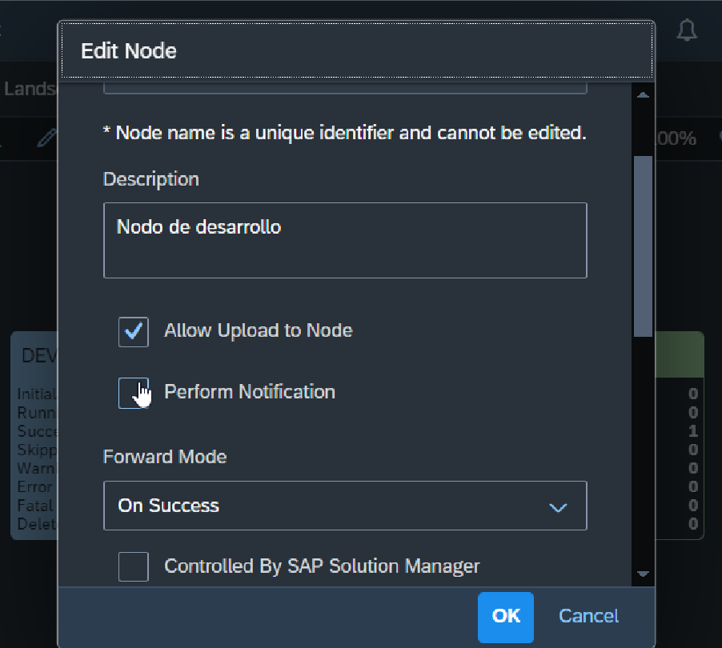

## 9. Checklist: en pocas palabras

1. Configurar el repositorio en Azure Repos o el SCM de preferencia.
   1. Crear el repositorio.
   2. Crear las ramas DEV y QAS.
   3. Bloquear el commit directo a cada rama: solo permitir el push por merge de un Pull Request aprobado por otra persona.
2. Generar todas las credenciales:
   1. Git (CI/CD)
   2. Webhook (CI/CD)
   3. BTP (CI/CD)
   4. CTM (CI/CD)
3. Generar los destinations de CTM: uno de deploy por subcuenta (idealmente OAuth2Password con usuario técnico).
4. Dar de alta el landscape de transporte en CTM (nodos y rutas).
5. Dar de alta los repositorios en CI/CD.
6. Dar de alta los jobs, uno por rama (DEV, QAS, main).
7. Configurar los webhooks en el SCM, uno por rama.
8. Configurar Alert Notification (action, condition, subscription) y activarlo en el job y en los nodos.

## Recursos

- [Get Started with SAP Continuous Integration and Delivery (tutorial de SAP)](https://developers.sap.com/tutorials/cicd-start-cap.html)
- [Deploy using CI/CD Pipelines (CAP)](https://cap.cloud.sap/docs/guides/deploy/cicd)
- [Integrate CI/CD with cTMS as part of SAP Cloud ALM (SAP Community)](https://blogs.sap.com/t5/technology-blogs-by-members/integrate-ci-cd-with-ctms-as-part-of-sap-cloud-alm/ba-p/13653010)
- SAP Help, manual de CTM: *Creating Destinations Using SAP Cloud Deployment Service with OAuth2Password Authentication*
- SAP KBA 3766638: el deploy desde CTM falla con 401 si el usuario del destination tiene MFA
